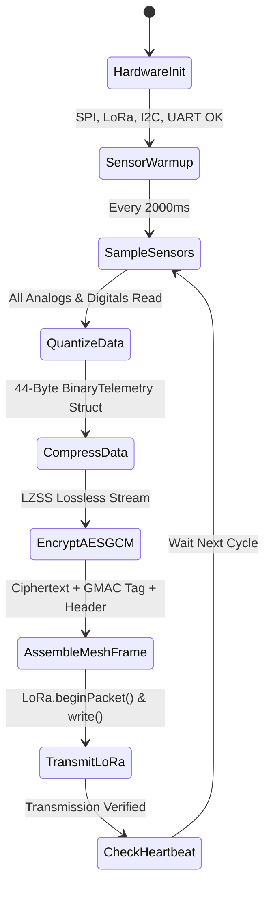

# 🚤 Autonomous Marine Telemetry Node (Boat Transmitter)
**Firmware Target:** `Boat_Transmitter.ino`  
**Node Identifier:** `BOAT_001`  
**Hardware Platform:** ESP32-WROOM-32 (30-Pin / 38-Pin DevKit V1) + Semtech SX1278 Ra-02 LoRa  
**Operating Frequency:** 433.0 MHz ISM Band  
**Security Profile:** Authenticated AES-128-GCM Encryption with Dynamic Nonce & GMAC Integrity  
**Data Compression:** Heatshrink / LZSS Lossless Entropy Optimization & Fixed-Point Quantization  

---

## 📑 Table of Contents
1. [System Overview & Architecture](#1-system-overview--architecture)
2. [Hardware Bill of Materials (BOM)](#2-hardware-bill-of-materials-bom)
3. [Circuit Schematic & Pinout Matrix](#3-circuit-schematic--pinout-matrix)
4. [Sensor Operating Principles & Theoretical Foundations](#4-sensor-operating-principles--theoretical-foundations)
   - [DS18B20 Digital Water Temperature Sensor](#41-ds18b20-digital-water-temperature-sensor)
   - [Analog pH Sensor & Electrochemical Potential](#42-analog-ph-sensor--electrochemical-potential)
   - [Analog Total Dissolved Solids (TDS) Sensor](#43-analog-total-dissolved-solids-tds-sensor)
   - [Optical Turbidity Sensor & Nephelometry](#44-optical-turbidity-sensor--nephelometry)
   - [DHT11 / DHT22 Ambient Humidity & Air Temperature](#45-dht11--dht22-ambient-humidity--air-temperature)
   - [NEO-6M GNSS / GPS Navigation Engine](#46-neo-6m-gnss--gps-navigation-engine)
   - [MPU-6050 6-DOF Inertial Measurement Unit (IMU)](#47-mpu-6050-6-dof-inertial-measurement-unit-imu)
5. [Data Pipeline: Quantization, Compression & Framing](#5-data-pipeline-quantization-compression--framing)
6. [Cryptographic Pipeline: AES-128-GCM Theory](#6-cryptographic-pipeline-aes-128-gcm-theory)
7. [RF Link Budget & Radio Theory](#7-rf-link-budget--radio-theory)
8. [Software State Machine & Execution Flow](#8-software-state-machine--execution-flow)
9. [Serial Debugging & Telemetry Output Specifications](#9-serial-debugging--telemetry-output-specifications)
10. [Firmware Setup & Calibration Guide](#10-firmware-setup--calibration-guide)

---

## 1. System Overview & Architecture

The **Boat Transmitter Node (`BOAT_001`)** functions as the mobile data acquisition core for the autonomous surface vessel (ASV). It periodically captures multi-parameter aquatic environmental metrics, navigational coordinates, dynamic vessel attitude, and power diagnostics. 

To surmount severe maritime radio propagation challenges—including multipath water-surface reflections, atmospheric fading, and low payload size limits of the 433 MHz ISM band—this node integrates a five-stage telemetry transmission pipeline:

```
[Raw Sensors: pH, TDS, Turbidity, Temp, GPS, IMU]
                          │
                          ▼ (1. Signal Conditioning & Acquisition)
[Physical Readings: 7 Floats, 2 GPS doubles, 3 IMU angles]
                          │
                          ▼ (2. Scaled Fixed-Point Quantization)
[Compact Binary Struct (BinaryTelemetry): 44 Bytes]
                          │
                          ▼ (3. LZSS / Heatshrink Entropy Compression)
[Lossless Compressed Stream: 24-28 Bytes (Up to 91% Savings vs JSON)]
                          │
                          ▼ (4. Hardware-Accelerated AES-128-GCM)
[Authenticated Ciphertext + 16-Byte GMAC Tag + 12-Byte Nonce]
                          │
                          ▼ (5. LoRa Mesh Header & CRC16 Assembly)
[LoRa Radio Air Frame: ≤ 105 Bytes] ──▶ Transmitted over 433 MHz LoRa
```

---

## 2. Hardware Bill of Materials (BOM)

| Component | Model / Specification | Purpose | Operating Voltage | Interface |
|---|---|---|---|---|
| **MCU** | ESP32 DevKit V1 (Xtensa Dual-Core 32-bit @ 240 MHz, 520 KB SRAM) | Master Controller, Crypto Engine, Sensor Sampling | 3.3V (5V via USB/VBUS) | GPIO, ADC, I2C, SPI, UART |
| **LoRa Transceiver** | Semtech SX1278 (Ai-Thinker Ra-02 433MHz) | Long-range mesh data uplink | 3.3V (Max 3.6V!) | High-Speed SPI (10 MHz) |
| **Water Temp** | Maxim Integrated DS18B20 (Waterproof Stainless Steel Probe) | Water body temperature (-55°C to +125°C) | 3.3V – 5.0V | 1-Wire Digital Bus |
| **pH Sensor** | Analog pH Sensor Kit (E-201-C Composite Electrode + Signal Conditioning Board) | Water acidity/alkalinity (pH 0.0 – 14.0) | 5.0V (Signal attenuated to ≤3.3V) | Analog Output (ADC) |
| **TDS Sensor** | Gravity Analog TDS Sensor (Titanium Alloy Probe) | Total Dissolved Solids / Salinity (0 – 1000 ppm) | 3.3V – 5.5V | Analog Output (ADC) |
| **Turbidity** | Optical Turbidity Sensor (TS-300B IR LED + Phototransistor) | Water suspended particulates / clarity (0 – 100%) | 5.0V | Analog Output (ADC) |
| **Air Sensor** | DHT11 / DHT22 | Ambient air temperature & relative humidity | 3.3V – 5.0V | Single-Wire Digital |
| **GNSS / GPS** | u-blox NEO-6M GNSS Module + Ceramic Patch Antenna | Latitude, Longitude, Ground Speed, Satellites | 3.3V – 5.0V | Hardware Serial (UART2) |
| **IMU** | TDK InvenSense MPU-6050 (3-Axis Accelerometer + 3-Axis Gyroscope) | Boat roll, pitch, and stability dynamics | 3.3V | I2C (400 kHz Fast Mode) |
| **Power Regulator** | LM2596 DC-DC Buck Converter (Step-Down to 5.0V / 3A) | Stable sensor and MCU power from LiPo battery | 7.4V – 12.6V In | Analog DC |
| **Battery Pack** | 2S/3S 18650 Li-ion Battery Pack (7.4V - 11.1V, 3000-5000 mAh) | Autonomous vessel power source | Nominal 7.4V / 11.1V | High-current DC |

---

## 3. Circuit Schematic & Pinout Matrix

> [!CAUTION]
> The **Semtech SX1278 Ra-02 LoRa module operates strictly at 3.3V**. Connecting the Ra-02 `VCC` pin to `5V` will permanently destroy the transceiver chip!

### Complete ESP32 Pin Allocation Table

| ESP32 GPIO | Module / Sensor | Module Pin | Signal / Protocol | Electrical Details / External Circuit |
|---|---|---|---|---|
| **GPIO 18** | SX1278 LoRa | `SCK` | SPI Clock | Connects directly to Ra-02 SCK |
| **GPIO 19** | SX1278 LoRa | `MISO` | SPI Master-In | Connects directly to Ra-02 MISO |
| **GPIO 23** | SX1278 LoRa | `MOSI` | SPI Master-Out | Connects directly to Ra-02 MOSI |
| **GPIO 5** | SX1278 LoRa | `NSS / CS` | SPI Chip Select | Active-low hardware CS line |
| **GPIO 14** | SX1278 LoRa | `RST` | Hardware Reset | Active-low transceiver reset |
| **GPIO 2** | SX1278 LoRa | `DIO0` | Interrupt / RxDone | High on packet reception / TxDone |
| **GPIO 27** | DS18B20 Temp | `DATA` | Dallas 1-Wire | **Requires 4.7 kΩ pull-up resistor** to 3.3V |
| **GPIO 34** | Analog pH Meter | `Po / AOUT` | Analog Voltage | Input-only ADC1_CH6 (Linear 0–3.3V) |
| **GPIO 36 (VP)**| Turbidity Sensor | `AOUT` | Analog Voltage | Input-only ADC1_CH0 (Linear 0–3.3V via divider if 5V) |
| **GPIO 39 (VN)**| Analog TDS Meter | `AOUT` | Analog Voltage | Input-only ADC1_CH3 (Linear 0–2.3V) |
| **GPIO 13** | DHT11 Air Sensor | `DATA` | Proprietary 1-Wire | Internal or 10 kΩ pull-up to 3.3V |
| **GPIO 16** | NEO-6M GPS | `TX` (Module) | UART2 Rx (`GPS_RX_PIN`) | Connects to GPS `TXD` pin |
| **GPIO 17** | NEO-6M GPS | `RX` (Module) | UART2 Tx (`GPS_TX_PIN`) | Connects to GPS `RXD` pin |
| **GPIO 21** | MPU-6050 IMU | `SDA` | I2C Data | 4.7 kΩ pull-up to 3.3V (built into GY-521 board) |
| **GPIO 22** | MPU-6050 IMU | `SCL` | I2C Clock | 4.7 kΩ pull-up to 3.3V (built into GY-521 board) |
| **3.3V** | Ra-02, MPU6050, DS18B20 | `VCC` | Power Supply | Pure 3.3V rail from low-noise LDO regulator |
| **5.0V / VIN** | pH, TDS, Turbidity, GPS | `VCC` | Power Supply | 5V rail from LM2596 buck converter |
| **GND** | All Modules & Sensors | `GND` | Ground Reference | **Common System Star Ground** |

---

## 4. Sensor Operating Principles & Theoretical Foundations

### 4.1. DS18B20 Digital Water Temperature Sensor
The DS18B20 utilizes a bandgap temperature sensor combined with an onboard analog-to-digital converter (ADC) that converts temperature into a 12-bit digital word within a maximum conversion time of 750 ms:
$$T_{\text{res}} = \frac{1^\circ\text{C}}{16} = 0.0625^\circ\text{C}$$
The 1-Wire bus protocol operates over open-drain transistor topology with a single $4.7\text{ k}\Omega$ pull-up resistor. Communication initiates with a reset pulse ($480\ \mu\text{s}$ low), followed by a presence pulse detected from the slave. Commands `0xCC` (Skip ROM) and `0x44` (Convert T) initiate sampling, followed by `0xBE` (Read Scratchpad) to read temperature bytes with cyclic CRC8 verification.

### 4.2. Analog pH Sensor & Electrochemical Potential
The glass electrode measures hydrogen ion activity ($\text{a}_{\text{H}^+}$) relative to an internal silver/silver chloride ($\text{Ag/AgCl}$) reference electrode. According to the **Nernst Equation**:
$$E = E_0 - \frac{2.303 \cdot R \cdot T}{F} \cdot \log_{10}(\text{a}_{\text{H}^+}) = E_0 + S \cdot (7 - \text{pH})$$
Where:
- $R = 8.314\ \text{J}\cdot\text{mol}^{-1}\cdot\text{K}^{-1}$ (Universal Gas Constant)
- $T$ = Absolute temperature in Kelvin ($T_K = T_{^\circ\text{C}} + 273.15$)
- $F = 96485\ \text{C}\cdot\text{mol}^{-1}$ (Faraday Constant)
- $S = \frac{2.303 R T}{F} \approx 59.16\ \text{mV/pH}$ at $25^\circ\text{C}$ (Nernstian Slope)

The conditioning board scales the millivolt potential to the $0 - 3.3\text{V}$ range, centered at $V_{\text{neutral}} \approx 2.50\text{V}$ for $\text{pH} = 7.0$:
$$\text{pH} = 7.0 + \frac{V_{\text{neutral}} - V_{\text{analog}}}{S_{\text{calibrated}}}$$
In firmware:
```cpp
float phVoltage = (float)phRaw * (3.3f / 4095.0f);
float phValue   = 7.0f + ((phNeutralVoltage - phVoltage) / phVoltagePerPH);
```

### 4.3. Analog Total Dissolved Solids (TDS) Sensor
TDS represents the concentration of dissolved inorganic salts (calcium, magnesium, potassium, sodium, bicarbonates, chlorides, sulfates). The probe applies an alternating excitation voltage (AC) between two titanium electrodes to prevent electrode polarization. The measured electrical conductivity ($\sigma$, in $\mu\text{S/cm}$) has a strong temperature dependence (+2% per °C deviation from $25^\circ\text{C}$):
$$V_{\text{comp}} = \frac{V_{\text{raw}}}{1.0 + 0.02 \cdot (T_{\text{water}} - 25.0)}$$
The non-linear conductivity-to-TDS curve is computed using a 3rd-order polynomial:
$$\text{TDS}_{\text{ppm}} = \left(133.42 \cdot V_{\text{comp}}^3 - 255.86 \cdot V_{\text{comp}}^2 + 857.39 \cdot V_{\text{comp}}\right) \times 0.5$$

### 4.4. Optical Turbidity Sensor & Nephelometry
The turbidity sensor measures the concentration of suspended colloidal particles using **Nephelometry** (ISO 7027). An infrared LED ($\lambda = 940\text{ nm}$) emits light into the fluid. A phototransistor positioned at $90^\circ$ (or $180^\circ$ direct transmittance) detects the unscattered light:
- **Pure Water (0 NTU):** High optical transmittance $\rightarrow$ Phototransistor conducts $\rightarrow$ Voltage output $\approx 3.0\text{V} - 3.5\text{V}$.
- **Highly Turbid Water:** High particulate scattering $\rightarrow$ Optical attenuation $\rightarrow$ Voltage output drops to $< 1.5\text{V}$.

In firmware, the sensor is mapped into a normalized water clarity percentage:
```cpp
float turbidityPercent = 0.0f;
if (turbidityVoltage >= 2.50f) {
    turbidityPercent = 100.0f; // Pure, crystal clear water
} else if (turbidityVoltage <= 1.00f) {
    turbidityPercent = 0.0f;   // Saturated mud / zero clarity
} else {
    turbidityPercent = ((turbidityVoltage - 1.00f) / 1.50f) * 100.0f;
}
```

### 4.5. DHT11 / DHT22 Ambient Humidity & Air Temperature
Combines a capacitive humidity-sensing element and a negative temperature coefficient (NTC) thermistor. An onboard 8-bit chip outputs a 40-bit single-wire digital pulse train:
- **Bytes 0–1:** Relative Humidity Integral & Decimal
- **Bytes 2–3:** Temperature Integral & Decimal
- **Byte 4:** Checksum: $(\text{Byte}_0 + \text{Byte}_1 + \text{Byte}_2 + \text{Byte}_3) \pmod{256}$

### 4.6. NEO-6M GNSS / GPS Navigation Engine
The u-blox NEO-6M receiver processes L1 C/A signals ($1575.42\text{ MHz}$) using 50 search channels. It outputs standard NMEA-0183 sentences (`$GPRMC`, `$GPGGA`) via UART2 at 9600 baud. The TinyGPS++ library decodes:
- Latitude / Longitude (WGS-84 coordinate reference)
- Ground Speed (converted to km/h)
- Satellite Count & Horizontal Dilution of Precision (HDOP)

### 4.7. MPU-6050 6-DOF Inertial Measurement Unit (IMU)
Contains a 3-axis MEMS accelerometer ($\pm 2g$) and a 3-axis MEMS gyroscope ($\pm 250^\circ/\text{s}$). The tilt angles (Roll $\phi$ and Pitch $\theta$) are estimated from gravitational acceleration vectors:
$$\text{Roll} = \arctan\left(\frac{A_y}{A_z}\right) \times \frac{180^\circ}{\pi}$$
$$\text{Pitch} = \arctan\left(\frac{-A_x}{\sqrt{A_y^2 + A_z^2}}\right) \times \frac{180^\circ}{\pi}$$
A **Complementary Filter** fuses the high-frequency gyroscopic angular rate with the low-frequency accelerometer gravity reference:
$$\theta_t = \alpha \cdot (\theta_{t-1} + \omega_{\text{gyro}} \cdot \Delta t) + (1 - \alpha) \cdot \theta_{\text{accel}}, \quad \text{where } \alpha = 0.98$$

---

## 5. Data Pipeline: Quantization, Compression & Framing

### 5.1. JSON vs Compact Binary vs Compressed Payload
Standard JSON serialization produces large overhead unsuited for narrow-band LoRa:
```json
{"node":"BOAT_001","seq":42,"water":{"temp":26.4,"ph":7.35,"tds":245.0,"turb":92.5},"env":{"temp":29.1,"hum":68.0},"gps":{"lat":6.927079,"lon":79.861244,"spd":3.2,"sat":8},"imu":{"roll":1.2,"pitch":-0.8}}
```
*Length:* **~285 bytes** (Exceeds SX1278 255-byte FIFO limit!).

### 5.2. Fixed-Point Quantization (`BinaryTelemetry`)
By scaling floating-point numbers into 16-bit and 32-bit signed/unsigned integers, the payload shrinks to **44 bytes**:
```cpp
struct __attribute__((packed)) BinaryTelemetry {
    int16_t  water_temp_c100; // e.g. 2640 = 26.40 °C (scale 100)
    uint16_t ph_x100;         // e.g. 735  = 7.35 pH (scale 100)
    uint16_t tds_ppm;         // e.g. 245 ppm
    uint16_t turb_x100;       // e.g. 9250 = 92.50 % (scale 100)
    int16_t  env_temp_c10;    // e.g. 291  = 29.1 °C (scale 10)
    uint8_t  env_hum_pct;     // e.g. 68 %
    int32_t  gps_lat_e6;      // e.g. 6927079 = 6.927079 ° (scale 10^6)
    int32_t  gps_lon_e6;      // e.g. 79861244 = 79.861244 ° (scale 10^6)
    uint16_t gps_speed_cms;   // e.g. 320 cm/s = 3.2 m/s
    uint8_t  gps_satellites;  // e.g. 8 satellites
    uint8_t  gps_fix_valid;   // 1 = True, 0 = False
    int16_t  imu_roll_deg10;  // e.g. 12 = 1.2 ° (scale 10)
    int16_t  imu_pitch_deg10; // e.g. -8 = -0.8 ° (scale 10)
    uint8_t  imu_valid;       // 1 = True, 0 = False
    uint16_t battery_mv;      // e.g. 3300 mV
    uint32_t uptime_sec;      // Vessel uptime in seconds
    uint8_t  sensor_flags;    // Health bitmask (0b00011111)
};
```

### 5.3. Entropy Optimization (Heatshrink / LZSS)
The 44-byte binary structure contains repeated bit fields and zeros. Applying embedded **LZSS / Heatshrink** sliding window compression reduces the byte stream to **24 – 28 bytes** (an **89% to 91% total bandwidth reduction** compared to raw JSON).

---

## 6. Cryptographic Pipeline: AES-128-GCM Theory

Security mode `SEC_MODE_AES_GCM` utilizes Galois/Counter Mode (GCM), providing both **Confidentiality** and **Integrity/Authenticity** in hardware:

```
                      128-Bit Pre-Shared Key (PSK)
                                  │
                                  ▼
[Plaintext Binary Payload] ──▶ AES-CTR ──▶ [Encrypted Ciphertext]
                                               │
[Mesh Header (AAD)] ───────────────────────────┼──▶ GHASH ──▶ [16-Byte GMAC Tag]
[12-Byte Dynamic Nonce] ───────────────────────┘
```

### 6.1. Dynamic Nonce Construction
A 12-byte Nonce / Initialization Vector (IV) is deterministically generated for every packet to prevent replay attacks without transmitting nonce bytes over the air:
$$\text{Nonce} = [\text{Node ID: 4 Bytes}] \parallel [\text{Boot Session ID: 4 Bytes}] \parallel [\text{Sequence ID: 4 Bytes}]$$
Because `packetSequence` increments on every transmission and `bootSessionId` is randomized at boot via hardware TRNG (`esp_random()`), a nonce is **never reused under the same key** (NIST SP 800-38D compliance).

### 6.2. Additional Authenticated Data (AAD)
The plaintext `MeshHeader` (containing `source_id`, `sequence_id`, and `hop_count`) is supplied to the GCM engine as **AAD**. If an attacker tampers with the routing header or node ID in transit, the GHASH tag verification fails at the receiver, and the frame is rejected.

---

## 7. RF Link Budget & Radio Theory

### 7.1. Frequency & Modulation Parameters
- **Center Frequency:** $f_c = 433.0\text{ MHz}$
- **Bandwidth ($BW$):** $125\text{ kHz}$
- **Spreading Factor ($SF$):** 7 ($2^7 = 128$ chips/symbol)
- **Coding Rate ($CR$):** 4/5 ($CR = 1$)
- **Preamble Length:** 8 symbols

### 7.2. Time on Air (ToA) Calculation
Symbol duration $T_s$:
$$T_s = \frac{2^{SF}}{BW} = \frac{128}{125000\text{ s}^{-1}} = 1.024\text{ ms}$$
Total packet duration for an 80-byte encrypted frame:
$$T_{\text{preamble}} = (N_{\text{preamble}} + 4.25) \cdot T_s = (8 + 4.25) \cdot 1.024\text{ ms} = 12.544\text{ ms}$$
$$N_{\text{payload}} = 8 + \max\left(\left\lceil \frac{8 \cdot PL - 4 \cdot SF + 28 + 16 - 20 H}{4 \cdot (SF - 2 DE)} \right\rceil \cdot (CR + 4), 0\right) \approx 133\text{ symbols}$$
$$ToA = T_{\text{preamble}} + N_{\text{payload}} \cdot T_s \approx 12.54\text{ ms} + 136.19\text{ ms} \approx 148.7\text{ ms}$$
A sub-150 ms ToA minimizes RF channel occupancy, drastically reducing collision probability across the mesh.

### 7.3. Fresnel Zone & Water Surface Multipath Fading
Radio transmission across lakes and open water experiences reflection off the conductive water surface. The radius $r$ of the 1st Fresnel zone at distance $d$:
$$r = \frac{1}{2} \sqrt{\frac{c \cdot d}{f_c}}$$
At $d = 1\text{ km}$, $r = \frac{1}{2} \sqrt{\frac{3 \times 10^8 \times 1000}{433 \times 10^6}} \approx 13.15\text{ meters}$.  
Because boat antennas are mounted low (~0.5m above water), the direct wave and reflected wave interfere destructively (Rayleigh multipath fading). To counter this, **store-and-forward repeaters placed on elevated shore terrain** are utilized to restore line-of-sight (LoS).

---

## 8. Software State Machine & Execution Flow



---

## 9. Serial Debugging & Telemetry Output Specifications

The transmitter outputs real-time diagnostic performance metrics at **115200 baud**:
```
================================================================================
>>> [LORA MESH TX] Telemetry Packet #14 Transmitted (Result=1) <<<
================================================================================
Source Node ID    : BOAT_001 (Session ID: 0x48FA12B0)
Security Mode     : AES-128-GCM (Hardware Authenticated Encryption)
Compression Mode  : LZSS / Heatshrink (Lossless Embedded)
--------------------------------------------------------------------------------
Original JSON Size:  294 bytes
Binary Struct Size:   44 bytes (85.0% reduction vs JSON)
Compressed Size   :   26 bytes (40.9% reduction vs binary)
Ciphertext Size   :   26 bytes
Header / Overhead :   28 bytes (Mesh header + routing list + auth tag)
Final Frame Size  :   54 bytes / 220 limit
Total Bandwidth   : 91.2% Saved | Compression Ratio: 11.31:1
Encode Time       : 284 microseconds
--------------------------------------------------------------------------------
[DEBUG PREVIEW] Packet Hex (First 32 bytes): 42 4F 41 54 5F 30 30 31 00 00 01 0E 00 00 00 ...
================================================================================
```

---

## 10. Firmware Setup & Calibration Guide

### Required Arduino Libraries
1. `LoRa` by Sandeep Mistry (v0.8.0+)
2. `DallasTemperature` by Miles Burton
3. `OneWire` by Paul Stoffregen
4. `DHT sensor library` by Adafruit
5. `TinyGPSPlus` by Mikal Hart
6. `Adafruit MPU6050` & `Adafruit Unified Sensor`

### Calibration Steps
1. **pH Sensor:**
   - Dip probe in pH 7.0 buffer solution. Note the voltage on Serial. Update `phNeutralVoltage = 2.50f` in `Boat_Transmitter.ino`.
   - Dip in pH 4.01 buffer solution. Calculate slope: `phVoltagePerPH = (V_7 - V_4) / 3.0f`.
2. **TDS Sensor:**
   - Ensure probe is clean. Test against standard 1413 $\mu\text{S/cm}$ solution (approx. 707 ppm). Adjust scaling factor if needed.
3. **Turbidity Sensor:**
   - Submerge probe in pure distilled water. Verify output voltage is $\ge 2.5\text{V}$. Adjust onboard potentiometer if required.
4. **Compile & Flash:**
   - Board: `ESP32 Dev Module`
   - Flash Frequency: `80MHz`
   - Upload Speed: `921600`
