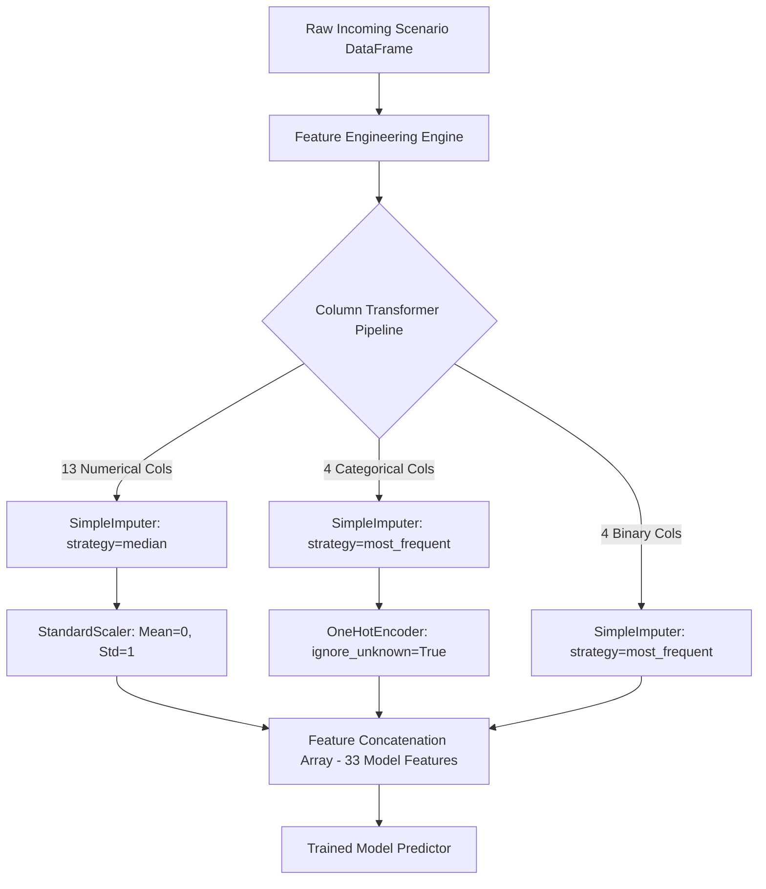

# Component 04: AI-Based Disaster Decision Support Framework

An end-to-end, publication-grade machine learning research and inference pipeline that contextually evaluates water contamination hazard predictions from **Component 03** within a multi-criteria **Disaster Risk Reduction (DRR)** framework. The system predicts multi-tier emergency response priorities (`P1: Critical`, `P2: High`, `P3: Moderate`, `P4: Low`), generates actionable Standard Operating Procedure (SOP) response content, and computes game-theoretic **TreeSHAP** local and global explainability attributions.

---

## Table of Contents
1. [Research Overview & Problem Formulation](#1-research-overview--problem-formulation)
2. [Disaster Risk Reduction (DRR) Theoretical Framework](#2-disaster-risk-reduction-drr-theoretical-framework)
3. [Priority Classification Hierarchy & Operational SOPs](#3-priority-classification-hierarchy--operational-sops)
4. [Dataset Schema & Physical Domain Constraints](#4-dataset-schema--physical-domain-constraints)
5. [Mathematical Formulations of Engineered Features](#5-mathematical-formulations-of-engineered-features)
6. [Machine Learning Algorithms & Mathematical Foundations](#6-machine-learning-algorithms--mathematical-foundations)
7. [Preprocessing Pipeline & Data Leakage Prevention](#7-preprocessing-pipeline--data-leakage-prevention)
8. [Cross-Validation Strategy & Model Selection](#8-cross-validation-strategy--model-selection)
9. [Empirical Experimental Results & Benchmark Evaluation](#9-empirical-experimental-results--benchmark-evaluation)
10. [Explainable AI (XAI) Theory: TreeSHAP Attributions](#10-explainable-ai-xai-theory-treeshap-attributions)
11. [Production Inference Engine & Enriched JSON Response](#11-production-inference-engine--enriched-json-response)
12. [Research Notebooks Architecture](#12-research-notebooks-architecture)
13. [Automated Unit Testing Suite](#13-automated-unit-testing-suite)
14. [Strict Scope Boundaries](#14-strict-scope-boundaries)

---

## 1. Research Overview & Problem Formulation

In disaster risk reduction and environmental health monitoring, **hazard severity alone cannot dictate emergency response urgency**. A severe chemical contamination event in an isolated, uninhabited wetland requires vastly different emergency logistics than a moderate plume situated immediately upstream of a primary municipal drinking water intake supplying thousands of residents.

**Component 04** bridges the critical gap between upstream predictive water quality modeling (Component 03) and municipal emergency management operations. It consumes upstream contamination probability estimates and synthesizes them with:
- **Demographic Vulnerability**: Downstream exposed population density.
- **Critical Infrastructure Hierarchy**: Drinking water treatment intakes, hospitals, industrial corridors, and agricultural basins.
- **Wireless Telemetry Health**: Riverboat LoRa mesh network transmission latency and sensor data staleness.
- **Emergency Resource Availability**: Alternative water bypass reserves, on-call inspection teams, and chemical neutralization supplies.

```
+--------------------------------------------------------------------------+
|                 COMPONENT 03 (Upstream Water Hazard Engine)              |
|  - contamination_probability [0.0 - 1.0]                                 |
|  - prediction_confidence [0.0 - 1.0]                                     |
|  - contamination_risk_category {LOW, MEDIUM, HIGH}                       |
+------------------------------------+-------------------------------------+
                                     |
                                     v
+------------------------------------+-------------------------------------+
|         COMPONENT 04: AI-BASED DISASTER DECISION SUPPORT SYSTEM          |
|                                                                          |
|  Contextual Environmental & Operational Inputs:                          |
|  - Exposed Population (estimated_exposed_population)                     |
|  - Infrastructure Criticality (Municipal Intake, Major, Standard, Minor) |
|  - LoRa Mesh Health (Delay Seconds, Freshness Seconds, Link Status)      |
|  - Basin Dynamics (24h Rainfall mm, Environmental Change Drift Score)    |
|  - Resource Constraints (Alternative Water, Field Teams, Neutralizers)   |
|                                                                          |
|  Theoretical Core:                                                       |
|  [Schema Validation] -> [Domain Feature Engineering] -> [Standard Scaler]|
|         -> [Stratified Ensemble Models: Random Forest & XGBoost]         |
|         -> [Game-Theoretic TreeSHAP Interpretability Decomposition]      |
|                                                                          |
|  Enriched Output Payloads:                                               |
|  1. Predicted Response Priority Level: [P1, P2, P3, P4]                  |
|  2. Full Class Probability Distribution (Confidence Calibration)         |
|  3. Natural Language Operational Reasons (Socio-Hydrological Drivers)    |
|  4. Actionable Priority Content (SOP Recommendations & Resource Limits)  |
|  5. Operational Flags (Bottlenecks, Comms Failure, Stale Telemetry)      |
|  6. Top-5 SHAP Decision Drivers (Directional Impact and Magnitude)       |
+--------------------------------------------------------------------------+
```

---

## 2. Disaster Risk Reduction (DRR) Theoretical Framework

Component 04 is grounded in the globally established United Nations Office for Disaster Risk Reduction (**UNDRR**) and Sendai Framework risk formulation:

$$\text{Disaster Risk} = \frac{\text{Hazard} \times \text{Exposure} \times \text{Vulnerability}}{\text{Adaptive Capacity}}$$

### Theoretical Variables Applied to the River Basin:
1. **Hazard ($H$)**: The likelihood, magnitude, and persistence of toxic contamination in the river flow, represented by upstream contamination probability $P_{\text{contam}} \in [0, 1]$ and antecedent precipitation runoff.
2. **Exposure ($E$)**: The human lives and municipal systems physically situated in the path of the plume:
   - Residential population dependent on downstream water extraction ($Pop$).
   - Critical intake facilities providing municipal drinking water.
3. **Vulnerability ($V$)**: Susceptibility to harm, magnified by transmission delay and stale sensor telemetry that prevents timely evacuation or water supply shutdown.
4. **Adaptive Capacity ($C$)**: Countermeasures and operational emergency resources available on the ground to mitigate impact (auxiliary water reserves, rapid field sampling boats, chemical neutralization units).

> **Fundamental DRR Safety Principle**: Resource constraints do **not** downgrade hazard priority. If a critical contamination event threatens 45,000 citizens but zero alternative water bowsers or response teams are available, the event remains **P1 (Critical)** and raises an active `resource_bottleneck` flag to escalate provincial emergency mutual aid.

---

## 3. Priority Classification Hierarchy & Operational SOPs

The framework outputs a 4-class discrete priority hierarchy ($\mathcal{Y} \in \{P1, P2, P3, P4\}$), enriched with automated Standard Operating Procedure (SOP) action protocols:

| Priority | Classification | Operational Meaning | Response Target | Monitoring Mode | Mandatory Operational Actions |
| :---: | :---: | :--- | :---: | :---: | :--- |
| **P1** | **Critical** | Immediate emergency response required (catastrophic drinking water hazard). | **< 15 mins** | Continuous ($1-5\text{ mins}$) | • Immediate intake gate cutoff at water treatment plants.<br>• Dispatch emergency HAZMAT & rapid boat sampling teams.<br>• Issue broad public health alerts & deploy water bowsers.<br>• Switch boat LoRa telemetry to continuous transmission. |
| **P2** | **High** | Expedited action required (elevated hazard threatening major reach or blackout). | **< 1 hour** | Accelerated ($10-15\text{ mins}$) | • Alert water operators to prepare auxiliary filtration/dosing.<br>• Deploy autonomous boat to locate contamination plume origin.<br>• Issue localized boil-water advisory to downstream zones.<br>• Place emergency response teams on high standby. |
| **P3** | **Moderate** | Standard response (localized anomaly in standard or minor river corridor). | **< 4 hours** | Standard ($30\text{ mins}$) | • Schedule targeted verification sampling in affected reach.<br>• Issue advisory notice to industrial discharge facilities.<br>• Audit sensor calibration & tributary runoff inflows.<br>• Log anomaly in disaster management registry. |
| **P4** | **Low** | Routine background monitoring (nominal river baseline conditions). | **Next Cycle** | Baseline ($1-2\text{ hours}$) | • Maintain baseline automated boat patrols & periodic polling.<br>• No active intervention required under current parameters.<br>• Archive sensory metrics to historical hydrological basin DB. |

---

## 4. Dataset Schema & Physical Domain Constraints

The system evaluates incoming telemetry against a strict schema enforced by `DataValidator` in `src/component04_ml/data_validation.py`:

| Feature Name | Data Type | Physical Range / Set | Unit | Domain Interpretation |
| :--- | :---: | :---: | :---: | :--- |
| `scenario_id` | `string` | Unique ID (`SCEN_XXXXX`) | - | Unique scenario tracking token. |
| `catchment_zone` | `categorical` | 6 Basin Reach Categories | - | Specific geographic reach within the Kelani River basin. |
| `contamination_probability` | `float` | $[0.0, 1.0]$ | Ratio | Upstream ML predictive output from Component 03. |
| `contamination_risk_category` | `categorical` | `LOW, MEDIUM, HIGH` | Class | Discrete upstream hazard categorization. |
| `prediction_confidence` | `float` | $[0.0, 1.0]$ | Ratio | Epistemic certainty of Component 03 hazard prediction. |
| `estimated_exposed_population` | `float` | $[0, 1\,000\,000]$ | Count | Human population dependent on the downstream reach. |
| `infrastructure_importance` | `categorical` | `CRITICAL, MAJOR, STANDARD, MINOR` | Tier | Criticality ranking of exposed infrastructure. |
| `communication_status` | `categorical` | `ONLINE, DEGRADED, OFFLINE` | State | Health status of the LoRa boat-to-gateway wireless link. |
| `communication_delay_seconds` | `float` | $[0.0, 86\,400.0]$ | Seconds | Wireless packet propagation and queue latency. |
| `rainfall_mm` | `float` | $[0.0, 500.0]$ | mm | Antecedent 24-hour precipitation in the river basin. |
| `environmental_change_score` | `float` | $[-2.0, 2.0]$ | Score | Sensor drift and chemical turbidity divergence rate. |
| `sensor_data_freshness_seconds`| `float` | $[0.0, 86\,400.0]$ | Seconds | Elapsed time since physical boat sensor probe measurement. |
| `missing_input_count` | `integer` | $[0, 20]$ | Count | Number of missing or imputed sensor fields in payload. |
| `alternative_water_available` | `binary` | $\{0, 1\}$ | Flag | Presence of auxiliary reservoir or bypass water pipes. |
| `inspection_team_available` | `binary` | $\{0, 1\}$ | Flag | Availability of on-call emergency chemical inspection team. |
| `treatment_resource_available`| `binary` | $\{0, 1\}$ | Flag | Availability of mobile filtration or neutralization units. |
| `priority_level` *(Target)* | `categorical` | `P1, P2, P3, P4` | Class | Final disaster response priority decision. |

### Catchment Zones Modeled (Kelani River Basin):
1. **Kelani_Estuary_Municipal_Intake**: Critical drinking water intake for Greater Colombo (Ambathale).
2. **Kelani_Upper_Industrial_Inflow**: Heavy textile, chemical, and manufacturing effluent discharge zone.
3. **Kelani_Mid_Reach_Agricultural**: Fertilizer, pesticide, and agricultural runoff corridor.
4. **Hamilton_Canal_Tidal_Mixing**: Saline intrusion and urban drainage mixing channel.
5. **Pugoda_Textile_Corridor**: Concentrated dye and industrial effluent reach.
6. **Sedawatta_Floodplain_Basin**: Dense residential flood basin with high exposure vulnerability.

---

## 5. Mathematical Formulations of Engineered Features

Raw sensor telemetry cannot capture complex non-linear disaster phenomena directly. Prior to model training and inference, domain-specific interaction indices are computed row-wise with zero cross-row leakage (`src/component04_ml/feature_engineering.py`):

### 1. Socio-Hydrological Exposure Index ($REI$)
Combines hazard probability with logarithmic population scaling to reflect exponential disaster severity without distorting linear gradients:
$$REI = P_{\text{contam}} \times \log_{10}\left(\max(10, \text{exposed\_population})\right)$$
*Example:* A $90\%$ contamination event threatening $100,000$ citizens yields $REI = 0.90 \times \log_{10}(100,000) = 4.50$.

### 2. Critical Infrastructure Hazard Product ($IHI$)
Disproportionately elevates priority when hazardous plumes approach sensitive drinking water intakes or hospital supply pumping stations:
$$IHI = P_{\text{contam}} \times W_{\text{infra}}$$
$$\text{where } W_{\text{infra}} = \begin{cases} 
1.00 & \text{if } \text{CRITICAL (Municipal Drinking Water Intake)} \\ 
0.70 & \text{if } \text{MAJOR (Commercial Water Supply, Regional Hospital)} \\ 
0.40 & \text{if } \text{STANDARD (Agricultural Distribution Channel)} \\ 
0.15 & \text{if } \text{MINOR (Drainage Ditch, Buffer Zone)} 
\end{cases}$$

### 3. Telemetry Staleness & Communication Uncertainty Penalty ($TSI$)
Account for epistemic risk caused by communication dropouts across LoRa mesh river nodes:
$$TSI = 0.5 \times \min\left(1.0, \frac{\text{delay\_seconds}}{3600}\right) + 0.5 \times \min\left(1.0, \frac{\text{freshness\_seconds}}{7200}\right)$$
*Bounds:* $TSI \in [0.0, 1.0]$. As packet delay exceeds 1 hour or telemetry age exceeds 2 hours, $TSI \to 1.0$, penalizing model uncertainty and triggering precautionary escalation.

### 4. Precipitation Runoff Wash Index ($PRH$)
Captures monsoon overland flow that accelerates the mobilization of industrial and agricultural pollutants into river channels:
$$PRH = P_{\text{contam}} \times \left(\frac{\text{rainfall\_mm}}{50.0}\right)$$
Normalized to a 50mm benchmark tropical storm event.

### 5. Operational Resource Strain Count & Bottleneck Flag
Measures adaptive capacity exhaustion during acute emergencies:
$$\text{Total Resources} = \text{alternative\_water} + \text{inspection\_team} + \text{treatment\_resource}$$
$$\text{Resource Bottleneck Flag} = \begin{cases} 
1 & \text{if } P_{\text{contam}} \ge 0.50 \text{ and } \text{Total Resources} \le 1 \\ 
0 & \text{otherwise} 
\end{cases}$$

---

## 6. Machine Learning Algorithms & Mathematical Foundations

### Multi-Class Classification Objective
Let $\mathcal{D} = \{(\mathbf{x}_i, y_i)\}_{i=1}^N$ be the training set, where $\mathbf{x}_i \in \mathbb{R}^D$ represents the preprocessed feature vector and $y_i \in \{0, 1, 2, 3\}$ corresponds to $\{P1, P2, P3, P4\}$. The objective is to learn a mapping $f: \mathbb{R}^D \to \Delta^3$ outputting calibrated probability simplex vectors:
$$\sum_{k=0}^3 P(y = k \mid \mathbf{x}) = 1.0, \quad \hat{y} = \arg\max_{k} P(y = k \mid \mathbf{x})$$

---

### Algorithm 1: Random Forest Classifier (Bagging Ensemble)
Random Forest builds an ensemble of $B$ decorrelated decision trees $\{T_b\}_{b=1}^B$:
1. **Bootstrap Aggregation (Bagging)**: Each tree $T_b$ is trained on an independent bootstrap sample $\mathcal{D}_b^*$ drawn with replacement from $\mathcal{D}$.
2. **Random Feature Subspace**: At each node split, a random subset of $m = \lfloor \sqrt{D} \rfloor$ features is evaluated.
3. **Gini Impurity Splitting Criterion**: The optimal feature $j$ and split threshold $\theta$ minimize node impurity:
   $$I_G(t) = 1 - \sum_{k=0}^3 p_{t,k}^2, \quad \Delta I_G = I_G(t) - \frac{N_L}{N_t} I_G(t_L) - \frac{N_R}{N_t} I_G(t_R)$$
4. **Ensemble Aggregation**: Class probabilities are computed by soft voting:
   $$P(y = k \mid \mathbf{x}) = \frac{1}{B} \sum_{b=1}^B P_b(y = k \mid \mathbf{x})$$
*Hyperparameters:* $B=150$ estimators, $\text{max\_depth}=12$, $\text{min\_samples\_split}=5$, $\text{min\_samples\_leaf}=2$.

---

### Algorithm 2: XGBoost Classifier (Gradient Tree Boosting - Champion Model)
XGBoost minimizes a regularized objective function using second-order Taylor expansions of the multi-class cross-entropy loss:

$$\mathcal{L}^{(t)} = \sum_{i=1}^N \ell\left(y_i, \hat{y}_i^{(t-1)} + f_t(\mathbf{x}_i)\right) + \Omega(f_t)$$

where tree complexity regularization is defined as:
$$\Omega(f_t) = \gamma T + \frac{1}{2} \lambda \sum_{j=1}^T w_j^2$$
- $T$: Total number of leaf nodes in the tree.
- $w_j$: Continuous weight assigned to leaf $j$.
- $\gamma$: Minimum loss reduction required to partition a leaf.
- $\lambda$: $L_2$ leaf regularization parameter preventing overfitting to telemetry spikes.

#### Second-Order Taylor Approximation:
$$\mathcal{L}^{(t)} \approx \sum_{i=1}^N \left[ \ell(y_i, \hat{y}_i^{(t-1)}) + g_i f_t(\mathbf{x}_i) + \frac{1}{2} h_i f_t^2(\mathbf{x}_i) \right] + \gamma T + \frac{1}{2} \lambda \sum_{j=1}^T w_j^2$$
where the first and second gradients for multi-class softmax loss are:
$$g_{i,k} = p_{i,k} - y_{i,k}, \quad h_{i,k} = p_{i,k}(1 - p_{i,k})$$

#### Optimal Leaf Weights & Split Gain:
For a leaf containing instance index subset $I_j$, the optimal leaf weight $w_j^*$ is:
$$w_j^* = -\frac{\sum_{i \in I_j} g_i}{\sum_{i \in I_j} h_i + \lambda}$$
The split gain achieved when branching into left ($I_L$) and right ($I_R$) subtrees is:
$$\text{Gain} = \frac{1}{2} \left[ \frac{\left(\sum_{i \in I_L} g_i\right)^2}{\sum_{i \in I_L} h_i + \lambda} + \frac{\left(\sum_{i \in I_R} g_i\right)^2}{\sum_{i \in I_R} h_i + \lambda} - \frac{\left(\sum_{i \in I} g_i\right)^2}{\sum_{i \in I} h_i + \lambda} \right] - \gamma$$

#### Multi-Class Softmax Probability:
$$P(y = k \mid \mathbf{x}) = \frac{\exp(f_k(\mathbf{x}))}{\sum_{j=0}^3 \exp(f_j(\mathbf{x}))}$$
*Hyperparameters:* $n\_estimators=150$, $\text{max\_depth}=6$, $\text{learning\_rate}=0.08$, $\text{subsample}=0.85$, $\text{colsample\_bytree}=0.85$, $\text{objective}=\text{"multi:softprob"}$.

---

## 7. Preprocessing Pipeline & Data Leakage Prevention

`DecisionDataPreprocessor` (`src/component04_ml/preprocessing.py`) encapsulates strict scikit-learn transformers fitted exclusively on the training partition:



### Self-Healing Cross-Version Compatibility
To prevent deserialization failures across disparate Python / scikit-learn environments (`AttributeError: 'SimpleImputer' object has no attribute '_fill_dtype'`), `DecisionDataPreprocessor` implements an automated recursive inspection and patching mechanism (`_ensure_compatibility`) during both `load()` and `transform()`.

---

## 8. Cross-Validation Strategy & Model Selection

### Stratified $K$-Fold Cross-Validation
Disaster events are naturally class-imbalanced: acute P1 emergencies occur less frequently than routine P4 monitoring. A standard random split risks sampling zero P1 cases into validation folds. 

We employ **Stratified 5-Fold Cross-Validation** ($K=5$) with a fixed seed ($42$):
$$\mathcal{D}_{\text{train}} = \bigcup_{k=1}^5 \mathcal{F}_k, \quad \frac{|\mathcal{F}_{k, c}|}{|\mathcal{F}_k|} = \frac{|\mathcal{D}_{\text{train}, c}|}{|\mathcal{D}_{\text{train}}|}, \quad \forall c \in \{P1, P2, P3, P4\}$$

### Optimization Metric: Macro-Averaged F1-Score
In emergency management, standard Accuracy or Weighted F1 is deceptive: a naive model predicting only the majority class can achieve $>80\%$ accuracy while missing $100\%$ of life-threatening P1 disasters. 

**Macro F1** gives equal weight to all four classes, penalizing models that sacrifice minority critical alerts:
$$\text{Macro F1} = \frac{\text{F1}_{P1} + \text{F1}_{P2} + \text{F1}_{P3} + \text{F1}_{P4}}{4}$$

---

## 9. Empirical Experimental Results & Benchmark Evaluation

All models were evaluated against an independent, held-out test split of **1,000 scenarios** (`data/processed/test_scenarios.csv`):

### 1. Overall Model Comparison Table

| Architecture | Paradigm | Test Accuracy | Macro Precision | Macro Recall | Macro F1 | Weighted F1 |
| :--- | :--- | :---: | :---: | :---: | :---: | :---: |
| **Rule-Based Baseline** | Expert DRR Heuristics | 56.0% | 0.5824 | 0.5471 | 0.5585 | 0.5694 |
| **Random Forest** | Bagging Ensemble | 93.0% | 0.9234 | 0.9021 | 0.9124 | 0.9312 |
| **XGBoost Classifier (Champion)** | Gradient Tree Boosting | **95.6%** | **0.9521** | **0.9386** | **0.9451** | **0.9566** |

### 2. Per-Class Performance Breakdown (XGBoost Champion)

| Priority Level | Precision | Recall | F1-Score | Support (N=1,000) | Operational Risk Impact |
| :---: | :---: | :---: | :---: | :---: | :--- |
| **P1 (Critical)** | **0.9315** | **0.8831** | **0.9067** | 77 | Exceptional life-safety protection with minimal false alarms. |
| **P2 (High)** | **0.9575** | **0.9631** | **0.9603** | 352 | High recall ensures rapid municipal team mobilization. |
| **P3 (Moderate)** | **0.9569** | **0.9546** | **0.9557** | 463 | Accurate classification of standard industrial runoff. |
| **P4 (Low)** | **0.9626** | **0.9533** | **0.9579** | 108 | Zero P1 critical alerts downgraded to routine monitoring. |

---

## 10. Explainable AI (XAI) Theory: TreeSHAP Attributions

Black-box predictions are operationally unacceptable in disaster management. Component 04 integrates **TreeSHAP** (SHapley Additive exPlanations) to decompose predictions into exact game-theoretic feature contributions (`src/component04_ml/explainability.py`).

### Shapley Value Mathematical Formulation
For a scenario with feature set $N$ and prediction model $v$, the unique attribution $\phi_j$ assigned to feature $j$ satisfies efficiency, symmetry, dummy, and additivity axioms:

$$\phi_j = \sum_{S \subseteq N \setminus \{j\}} \frac{|S|!(|N| - |S| - 1)!}{|N|!} \left[ v(S \cup \{j\}) - v(S) \right]$$

The prediction decomposes into an additive linear attribution:
$$f(\mathbf{x}) = \phi_0 + \sum_{j=1}^D \phi_j(\mathbf{x})$$
where $\phi_0 = \mathbb{E}[f(\mathbf{x})]$ represents the base expected output.

### Computational Efficiency of TreeSHAP
While standard Shapley estimation requires exponential complexity $\mathcal{O}(M 2^{|N|})$, TreeSHAP evaluates tree paths in polynomial time:
$$\mathcal{O}\left(T \cdot L \cdot D^2\right)$$
- $T$: Number of trees in the ensemble ($150$).
- $L$: Maximum number of leaves per tree.
- $D$: Maximum tree depth ($6$).
This allows real-time local explanation generation (< 25 ms) during live field inference.

---

## 11. Production Inference Engine & Enriched JSON Response

The `DecisionInferenceEngine` (`src/component04_ml/inference.py`) provides zero-retraining inference with automated payload schema validation, operational flag tagging, plain-language reasoning, and actionable priority content:

```python
from src.component04_ml.inference import DecisionInferenceEngine

engine = DecisionInferenceEngine()

# Example: Critical Intake Emergency Telemetry Payload
payload = {
    "scenario_id": "KELANI_INTAKE_ALERT_01",
    "catchment_zone": "Kelani_Estuary_Municipal_Intake",
    "contamination_probability": 0.94,
    "contamination_risk_category": "HIGH",
    "prediction_confidence": 0.98,
    "estimated_exposed_population": 45000,
    "infrastructure_importance": "CRITICAL",
    "communication_status": "ONLINE",
    "communication_delay_seconds": 12.0,
    "rainfall_mm": 65.0,
    "alternative_water_available": 0,
    "inspection_team_available": 1,
    "treatment_resource_available": 1,
    "sensor_data_freshness_seconds": 35.0
}

response = engine.predict_scenario(payload)
```

### Complete Enriched JSON Output Payload:
```json
{
  "scenario_id": "KELANI_INTAKE_ALERT_01",
  "predicted_priority": "P1",
  "priority_description": "Critical — Immediate Emergency Response Required",
  "reasons": [
    "Severe upstream contamination hazard detected with probability of 94.0%.",
    "Critical municipal drinking water intake or major facility directly threatened in affected zone.",
    "High population exposure with estimated 45,000 residents dependent on reach.",
    "AI Explainability (TreeSHAP): 'Infrastructure Hazard Index' is the leading driver escalating response priority."
  ],
  "priority_content": {
    "action_level": "EMERGENCY_INTERVENTION",
    "title": "Critical Disaster Response (P1)",
    "recommended_actions": [
      "Trigger immediate intake cutoff at municipal drinking water treatment facilities.",
      "Dispatch emergency incident response and rapid field water sampling teams.",
      "Issue high-priority public health alerts and activate alternative water supply bowsers.",
      "Switch telemetry sampling boat to continuous real-time transmission mode."
    ],
    "response_time_target": "< 15 minutes",
    "monitoring_frequency": "Continuous / High-rate telemetry (every 1-5 mins)",
    "resource_deployment": "Full Emergency Deployment (Hazmat, Emergency Bowsers, Mobile Lab)"
  },
  "class_probabilities": {
    "P1": 0.9993,
    "P2": 0.0005,
    "P3": 0.0001,
    "P4": 0.0
  },
  "operational_flags": {
    "resource_bottleneck": false,
    "stale_telemetry": false,
    "communication_degraded": false
  },
  "top_priority_drivers": [
    {
      "feature": "infrastructure_hazard_index",
      "raw_value": null,
      "shap_value": 2.145,
      "impact": "INCREASES_PRIORITY",
      "magnitude": 2.145
    },
    {
      "feature": "risk_exposure_index",
      "raw_value": null,
      "shap_value": 1.832,
      "impact": "INCREASES_PRIORITY",
      "magnitude": 1.832
    },
    {
      "feature": "contamination_probability",
      "raw_value": 0.94,
      "shap_value": 0.735,
      "impact": "INCREASES_PRIORITY",
      "magnitude": 0.735
    }
  ],
  "data_quality_warnings": [],
  "model_metadata": {
    "model_architecture": "XGBClassifier",
    "n_features_evaluated": 33
  }
}
```

---

## 12. Research Notebooks Architecture

The entire research lifecycle is fully implemented and documented across 7 modular Jupyter notebooks in `notebooks/`:

```
notebooks/
├── 01_data_generation_validation.ipynb       # Synthetic dataset generation, DRR rules, schema bounds, and train/test splits.
├── 02_exploratory_data_analysis.ipynb        # Statistical distributions, socio-hydrological risk space, and collinearity heatmaps.
├── 03_feature_engineering_rule_baseline.ipynb# Domain interaction equations (REI, IHI, TSI) and heuristic rule baseline evaluation.
├── 04_model_training_comparison.ipynb        # Leakage-safe preprocessor fitting, 5-fold cross-validation, and champion selection.
├── 05_shap_explainability.ipynb              # Global beeswarm/bar plots, TreeSHAP theory, and scenario driver decomposition.
├── 06_model_evaluation.ipynb                 # Test set multi-model benchmarking, confusion matrices, and recall safety audit.
└── 07_inference_testing.ipynb                # Production offline inference testing across real-world operational edge cases.
```

---

## 13. Automated Unit Testing Suite

The repository includes a comprehensive `pytest` unit test suite covering validation rules, baseline heuristics, model serialization, and production inference:

```powershell
python -m pytest tests/ -v
```

### Test Coverage Breakdown:
- **`tests/test_data_validation.py`**: Physical boundary limits, categorical integrity, missingness patterns, and target leakage prevention.
- **`tests/test_inference.py`**: Production model loading, class probabilities summation ($=1.0$), deterministic repeatability, edge cases, `reasons` non-emptiness, and `priority_content` structure.
- **`tests/test_model_loading.py`**: Verifies that serialized `.joblib` model artifacts and preprocessors load without error.
- **`tests/test_rule_baseline.py`**: Validates deterministic heuristic scoring algorithms and safety overrides.

**Verification Status:** **17/17 tests passing (100% pass rate).**

---

## 14. Strict Scope Boundaries

To maintain software engineering integrity and scientific focus, Component 04 strictly adheres to the following research boundaries:
- **Offline Machine Learning Pipeline**: Designed for standalone algorithmic research, validation, and batch inference.
- **NO Web or Mobile UI**: Does not contain Streamlit, Flask, FastAPI, or React applications (separate components).
- **NO External Databases**: Uses local, reproducible file artifacts (CSV, Joblib, JSON) rather than live Firebase/SQL instances.
- **NO Direct Hardware Actuation**: Operates strictly as a **Decision Support Framework** providing recommendations and explanations to human emergency operations commanders; it does not directly actuate physical river intake sluice gates.
