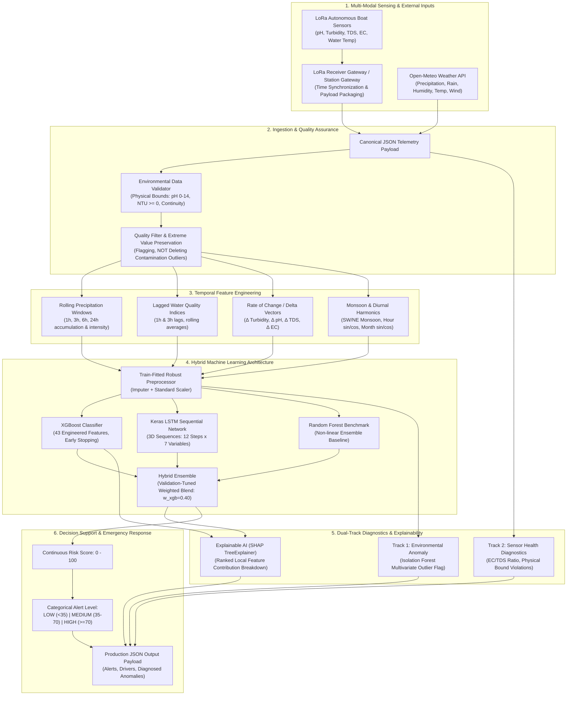

# Component 03: Hybrid Explainable Contamination Risk Prediction Framework

[](https://www.python.org/)
[](https://scikit-learn.org/)
[](https://github.com/slundberg/shap)
[]()

Part of the research system:
**Adaptive Environmental Intelligence for Early Water Contamination Detection and Disaster Response**

---

## 1. Executive Research Summary & Problem Statement

Water quality surveillance across tropical river basins (e.g., the Kelani River catchment in Sri Lanka) faces acute challenges from sudden industrial chemical discharges, agricultural runoff, and monsoon flash-flooding. Conventional fixed water monitoring stations are spatially sparse and offer only retrospective status alerts without predictive foresight.

**Component 03** develops an end-to-end, research-grade, explainable machine learning system that ingests telemetry from mobile LoRa autonomous water-sampling boats, fuses it with Open-Meteo precipitation forecasts, and predicts the **risk of water contamination across a forward-looking 3-hour horizon ($t+1$ to $t+12$ time steps at 15-minute intervals)**.

### Key Innovations
1. **Coupled Hydrodynamic Simulation & Feature Engineering**: Captures delayed runoff-turbidity response (1–3 hour hysteresis), chemical dilution vs. industrial acidic discharges, and monsoon seasonality.
2. **Leakage-Safe Chronological Partitioning**: Guarantees zero lookahead bias by strictly partitioning time series into Train (65%), Validation (15%), and Test (20%) subsets with backwards-only rolling statistics.
3. **Hybrid Ensemble Architecture**: Fuses structured gradient-boosted decision trees (XGBoost) with temporal sequence deep learning (Keras LSTM) and ensemble baselines (Random Forest) via validation-optimized probability blending.
4. **Dual-Track Anomaly Detection**: Separates genuine multivariate environmental contamination anomalies (Isolation Forest) from hardware probe faults, sensor drift, or communication packet corruption (heuristic algorithmic diagnostics).
5. **Explainable AI (XAI)**: Provides global Shapley attributions (beeswarm plots) and local instance explanations for every real-time prediction, identifying the precise physical drivers (e.g., surging electrical conductivity or accumulated precipitation).
6. **Production Standalone Inference**: Standalone CLI script (`inference/predict.py`) executing zero-retraining inference (< 15 ms latency) from JSON sensor payloads.

---

## 2. System Architecture & Telemetry Pipeline



---

## 3. Physical Parameters & Feature Ontology

| Parameter | Symbol / Variable | Unit | Valid Physical Range | Domain Interpretation |
| :--- | :--- | :--- | :--- | :--- |
| **pH Level** | `ph` | pH | 0.0 – 14.0 | Neutral freshwater is 6.5–8.5. Drops below 6.0 indicate acid runoff or industrial discharge. |
| **Turbidity** | `turbidity_ntu` | NTU | 0.0 – 1000.0 | Suspended particulate matter. Baseline river: 5–20 NTU; storm runoff > 150 NTU. |
| **Total Dissolved Solids** | `tds_ppm` | ppm (mg/L) | 0.0 – 5000.0 | Dissolved inorganic salts and organic matter. Natural freshwater: 50–300 ppm. |
| **Electrical Conductivity** | `ec_us_cm` | µS/cm | 0.0 – 10000.0 | Ability to conduct current. Freshwater ratio: $\text{EC} \approx 1.5 - 2.5 \times \text{TDS}$. |
| **Water Temperature** | `water_temp_c` | °C | 15.0 – 45.0 | Tropical river ambient range: 24–32 °C. Impacts dissolved oxygen and reaction kinetics. |
| **Precipitation** | `rainfall_mm` | mm | 0.0 – 300.0 | Rainfall depth over 15-minute interval. Drives overland sediment and contaminant flux. |
| **1h Accumulated Rain** | `rain_1h_mm` | mm | 0.0 – 300.0 | Trailing 4-step rolling sum. Immediate flash flood and surface wash proxy. |
| **3h Accumulated Rain** | `rain_3h_mm` | mm | 0.0 – 500.0 | Trailing 12-step rolling sum. Catchment saturation and delayed runoff driver. |
| **6h / 24h Rain** | `rain_6h_mm`, `rain_24h_mm` | mm | 0.0 – 1000.0 | Extended hydrological event accumulation. |
| **Turbidity Lag 1h** | `turbidity_lag_1h` | NTU | 0.0 – 1000.0 | Memory marker to quantify rate of turbidity rise. |
| **Turbidity Change Rate** | `turbidity_change_rate` | NTU/h | -500.0 – 500.0 | First-order temporal derivative $\frac{d(\text{Turbidity})}{dt}$. |
| **Southwest Monsoon** | `is_monsoon` | binary | 0 or 1 | May–September (SW) and December–February (NE) monsoon indicator. |

---

## 4. Theoretical & Mathematical Foundations

### 4.1 Riverine Hydrodynamic Transport & Contaminant Kinetics

Contaminant fate and transport along tropical river corridors are governed by the one-dimensional **Advection-Dispersion-Reaction Equation (ADRE)**:

$$\frac{\partial C(x, t)}{\partial t} + u \frac{\partial C(x, t)}{\partial x} = D_L \frac{\partial^2 C(x, t)}{\partial x^2} - k C(x, t) + \frac{S(x, t)}{A}$$

Where:
* $C(x, t)$: Longitudinal cross-sectional mean solute concentration ($\text{mg/L}$ or $\text{ppm}$).
* $u = \frac{Q}{A}$: Cross-sectional average longitudinal flow velocity ($\text{m/s}$), driven by discharge $Q$ ($\text{m}^3\text{/s}$) and wetted cross-sectional area $A$ ($\text{m}^2$).
* $D_L$: Longitudinal dispersion coefficient ($\text{m}^2\text{/s}$), conventionally modeled via Elder's empirical formulation:
  $$D_L \approx 5.93 \cdot d \cdot u_*$$
  where $d$ is river depth ($\text{m}$) and $u_* = \sqrt{g R_h S_0}$ is the shear velocity ($\text{m/s}$).
* $k$: First-order non-conservative decay or particulate settling rate coefficient ($\text{s}^{-1}$).
* $S(x, t)$: Source/sink mass flux per unit channel length ($\text{g}\cdot\text{m}^{-1}\text{s}^{-1}$).

#### 4.1.1 Rainfall-Runoff Hysteresis & Delayed Sediment Delivery
When precipitation occurs over a river catchment, overland sediment wash does not coincide instantaneously with rainfall peak. Catchment storage and overland travel times impose a physical delay $\tau_{lag}$ (time of concentration $t_c$):

$$Q_{runoff}(t) = C_{runoff} \cdot A_{catchment} \cdot I(t - \tau_{lag})$$

In the feature engineering pipeline, this hysteresis is captured via trailing rolling aggregates:
* **Immediate Wash** ($1\text{h} = 4 \text{ steps}$): Surface wash of immediate riparian soils.
* **Catchment Saturated Peak** ($3\text{h} = 12 \text{ steps}$): Peak overland sediment delivery matching the forward prediction horizon $t+3\text{h}$.
* **Hysteresis Loop Quantification**: Represented by the rate-of-change vector:
  $$\Delta \text{Turbidity}(t) = \frac{\text{Turbidity}(t) - \text{Turbidity}(t - \Delta t)}{\Delta t}$$

#### 4.1.2 Dilution Dynamics vs. Industrial Point-Source Discharge
The pipeline explicitly captures two contrasting physical phenomena:
1. **Precipitation Runoff Event**:
   High rainfall generates heavy particulate wash (surging turbidity $\text{NTU} \gg 50$) while concurrently **diluting** ambient dissolved salts, yielding reduced Total Dissolved Solids ($\text{TDS}$) and Electrical Conductivity ($\text{EC}$):
   $$\lim_{Q_{runoff} \to \infty} C_{TDS}(t) \to C_{rain} \approx 10 - 30\text{ ppm}$$
2. **Illicit Industrial Discharge (Dry or Baseline Flow)**:
   Chemical discharge introduces concentrated ionic solutes under low river discharge, causing sharp spikes in $\text{TDS}$ and $\text{EC}$ accompanied by abrupt drops in $\text{pH}$ ($\text{pH} < 6.0$) completely independent of precipitation:
   $$C_{mix} = \frac{Q_{base} C_{base} + Q_{in} C_{in}}{Q_{base} + Q_{in}}$$

---

### 4.2 Physicochemical Sensing & Electrochemistry Theory

#### 4.2.1 Potentiometric pH Measurement via Nernst Equation
The boat's analog glass electrode probe measures hydrogen ion activity $a_{\text{H}^+}$ relative to an internal $\text{Ag/AgCl}$ reference cell. The cell electromotive force $E$ obeys the **Nernst Equation**:

$$E = E_0 - \frac{2.303 R T}{n F} \cdot \log_{10}(a_{\text{H}^+}) = E_0 - S(T) \cdot (\text{pH} - 7.0)$$

Where:
* $E_0$: Standard electrode potential at neutral $\text{pH} = 7.0$ ($\approx 2.50\text{ V}$ baseline bias).
* $R = 8.314\text{ J}\cdot\text{mol}^{-1}\text{K}^{-1}$: Universal gas constant.
* $T$: Absolute temperature in Kelvin ($T_K = T_C + 273.15$).
* $F = 96485\text{ C}\cdot\text{mol}^{-1}$: Faraday constant.
* $S(T) = \frac{2.303 R T}{F}$: Theoretical Nernstian slope ($\approx 59.16\text{ mV/pH}$ at $25^\circ\text{C}$).

The firmware applies temperature compensation via the DS18B20 water temperature probe:
$$\text{pH}(T) = 7.0 + \frac{V_{neutral} - V_{adc}}{S(25^\circ\text{C}) \cdot \frac{T_K}{298.15}}$$

#### 4.2.2 Electrical Conductivity (EC) & Total Dissolved Solids (TDS)
Electrical conductivity measures the solution's ionic capacity to conduct electric current between two immersed electrodes. Specific conductance is normalized to standard $25^\circ\text{C}$ reference:

$$\kappa_{25} = \frac{\kappa_T}{1 + \alpha_{temp} (T - 25.0)}$$

Where $\alpha_{temp} \approx 0.019 - 0.021\text{ }^\circ\text{C}^{-1}$ is the temperature compensation coefficient for natural waters.

TDS is proportional to conductivity through the empirical conversion factor $k_e$:
$$\text{TDS}_{\text{ppm}} = k_e \cdot \kappa_{25} \quad (\mu\text{S/cm})$$

In unpolluted tropical freshwater, $k_e$ resides strictly between **$0.55$ and $0.70$**. A significant departure ($\frac{\text{EC}}{\text{TDS}} < 1.4$ or $> 2.6$) serves as a primary flag for sensor drift or hardware probe malfunction (Track 2 diagnostics).

#### 4.2.3 Optical Turbidity Nephelometry
The turbidity probe operates on nephelometric scattering at $90^\circ$ to the incident infrared beam ($850\text{ nm}$ LED). Light scattering off suspended colloidal particles conforms to Mie scattering and the Beer-Lambert attenuation law:

$$I_s(90^\circ) = I_0 \cdot \phi \cdot N_p \cdot e^{-\mu_{ext} L}$$

Where $I_0$ is incident intensity, $\phi$ is the particle scattering cross-section, $N_p$ is particle number density, and $\mu_{ext}$ is the extinction coefficient.

---

### 4.3 Multi-Metric Water Quality Index (WQI) Formulation

The system calculates an immediate, objective Water Quality Index derived from Canadian Council of Ministers of the Environment (CCME) and National Sanitation Foundation (NSF) weighted formulations.

Each raw physical parameter $x_i$ is mapped to a standardized sub-index $q_i \in [0.0, 100.0]$, where $100.0$ represents pristine natural water:

$$\begin{aligned}
q_{\text{pH}} &= \max\left(0.0, \; 100.0 - 35.0 \cdot |\text{pH} - 7.0|\right) \\
q_{\text{turb}} &= 100.0 \cdot \exp\left(-0.025 \cdot \max(0, \text{turbidity})\right) \\
q_{\text{tds}} &= 100.0 \cdot \exp\left(-0.0018 \cdot \max(0, \text{tds})\right) \\
q_{\text{ec}} &= 100.0 \cdot \exp\left(-0.0012 \cdot \max(0, \text{ec})\right) \\
q_{\text{temp}} &= \max\left(0.0, \; 100.0 - 10.0 \cdot \max(0, |\text{temp} - 26.5| - 1.5)\right)
\end{aligned}$$

The composite **Water Quality Index (WQI)** aggregates sub-indices through domain-expert weights satisfying $\sum_{i=1}^5 w_i = 1.0$:

$$\text{WQI} = 0.25 \cdot q_{\text{pH}} + 0.25 \cdot q_{\text{turb}} + 0.20 \cdot q_{\text{tds}} + 0.20 \cdot q_{\text{ec}} + 0.10 \cdot q_{\text{temp}}$$

#### Categorical Water Quality Rating Matrix
* **$\text{WQI} \ge 90.0$**: **EXCELLENT** (Pristine river baseline)
* **$70.0 \le \text{WQI} < 90.0$**: **GOOD** (Normal tropical stream)
* **$50.0 \le \text{WQI} < 70.0$**: **FAIR** (Elevated turbidity or dissolved load)
* **$25.0 \le \text{WQI} < 50.0$**: **POOR** (Active contamination advisory)
* **$\text{WQI} < 25.0$**: **VERY POOR** (Severe pollution / toxic event)

An immediate contamination condition is triggered if $\text{WQI} < 50.0$ OR any critical physical parameter breaches legal drinking/irrigation safety boundaries ($\text{pH} \notin [6.0, 9.0]$, $\text{turbidity} > 50\text{ NTU}$, $\text{TDS} > 600\text{ ppm}$, $\text{EC} > 1200\text{ }\mu\text{S/cm}$).

---

### 4.4 Multi-Horizon Predictive Risk Formulation & Zero-Lookahead Partitioning

#### 4.4.1 Prediction Problem Formalization
Let $\mathbf{x}_t \in \mathbb{R}^{d}$ represent the physical sensor observation vector at discrete time step $t$ ($15$-minute sampling rate). Let $\mathbf{w}_t \in \mathbb{R}^{p}$ denote the exogenous meteorological state vector from Open-Meteo.

The objective is to compute the conditional probability of a downstream contamination event occurring at a forward horizon $h = 12$ steps ($3\text{ hours}$ into the future):

$$P\left(y_{t+h} = 1 \;\middle|\; \mathcal{H}_t\right) = f_\theta\left(\mathbf{x}_t, \mathbf{x}_{t-1}, \dots, \mathbf{x}_{t-W}, \mathbf{w}_t, \dots, \mathbf{w}_{t+h}\right)$$

Where $\mathcal{H}_t$ is the historical information set available strictly at or before time $t$.

#### 4.4.2 Mathematical Guarantee of Zero Lookahead Bias
To eliminate temporal data leakage, all feature extraction functions $g_j(\cdot)$ are strictly **causal** and **backward-looking**:

$$\mu_{t, W} = \frac{1}{W} \sum_{k=0}^{W-1} x_{t-k}, \quad \sigma_{t, W}^2 = \frac{1}{W-1} \sum_{k=0}^{W-1} (x_{t-k} - \mu_{t, W})^2$$

No centered or forward-looking rolling windows are permitted:
$$\forall t' > t, \quad \frac{\partial g_j(\mathbf{x}_t)}{\partial x_{t'}} \equiv 0$$

Furthermore, chronological partitioning is enforced across all 140,160 observations:
* **Train Set** ($65\%$): January 1, 2025 – August 25, 2025 ($91,104$ steps)
* **Validation Set** ($15\%$): August 25, 2025 – October 20, 2025 ($21,024$ steps)
* **Test Set** ($20\%$): October 20, 2025 – December 31, 2025 ($28,032$ steps)

All imputation statistics ($\mu_{train}$) and standard scalers ($\mu_{train}, \sigma_{train}$) are fitted **exclusively on the Train subset** and frozen during validation and test evaluation.

---

### 4.5 Hybrid Ensemble Learning Theory

#### 4.5.1 Extreme Gradient Boosting (XGBoost)
XGBoost minimizes a regularized objective over $K$ additive regression trees:

$$\mathcal{L}^{(m)} = \sum_{i=1}^N l\left(y_i, \hat{y}_i^{(m-1)} + f_m(\mathbf{x}_i)\right) + \Omega(f_m)$$

Applying second-order Taylor expansion around the previous prediction $\hat{y}_i^{(m-1)}$:

$$\tilde{\mathcal{L}}^{(m)} \approx \sum_{i=1}^N \left[ g_i f_m(\mathbf{x}_i) + \frac{1}{2} h_i f_m^2(\mathbf{x}_i) \right] + \gamma T_m + \frac{1}{2} \lambda \sum_{j=1}^{T_m} w_j^2$$

Where the first and second gradients of the logistic loss $l(y_i, p_i) = -y_i \ln p_i - (1 - y_i) \ln(1 - p_i)$ are:
$$g_i = p_i - y_i, \quad h_i = p_i (1 - p_i)$$

For each leaf $j$ with sample index set $I_j = \{i \mid q(\mathbf{x}_i) = j\}$, the optimal weight $w_j^*$ and split score gain are:
$$w_j^* = -\frac{\sum_{i \in I_j} g_i}{\sum_{i \in I_j} h_i + \lambda}, \quad \text{Gain} = \frac{1}{2} \left[ \frac{(\sum_{i \in I_L} g_i)^2}{\sum_{i \in I_L} h_i + \lambda} + \frac{(\sum_{i \in I_R} g_i)^2}{\sum_{i \in I_R} h_i + \lambda} - \frac{(\sum_{i \in I} g_i)^2}{\sum_{i \in I} h_i + \lambda} \right] - \gamma$$

#### 4.5.2 Long Short-Term Memory (LSTM) Recurrent Mechanics
The temporal sequence deep learning model processes input tensors $\mathbf{X} \in \mathbb{R}^{B \times 12 \times 7}$ through gated recurrent units to capture non-linear temporal delays:

$$\begin{aligned}
\mathbf{f}_t &= \sigma\left(\mathbf{W}_f [\mathbf{h}_{t-1}, \mathbf{x}_t] + \mathbf{b}_f\right) \quad &&\text{(Forget Gate)} \\
\mathbf{i}_t &= \sigma\left(\mathbf{W}_i [\mathbf{h}_{t-1}, \mathbf{x}_t] + \mathbf{b}_i\right) \quad &&\text{(Input Gate)} \\
\tilde{\mathbf{C}}_t &= \tanh\left(\mathbf{W}_c [\mathbf{h}_{t-1}, \mathbf{x}_t] + \mathbf{b}_c\right) \quad &&\text{(Candidate Cell State)} \\
\mathbf{C}_t &= \mathbf{f}_t \odot \mathbf{C}_{t-1} + \mathbf{i}_t \odot \tilde{\mathbf{C}}_t \quad &&\text{(Updated Memory Cell)} \\
\mathbf{o}_t &= \sigma\left(\mathbf{W}_o [\mathbf{h}_{t-1}, \mathbf{x}_t] + \mathbf{b}_o\right) \quad &&\text{(Output Gate)} \\
\mathbf{h}_t &= \mathbf{o}_t \odot \tanh\left(\mathbf{C}_t\right) \quad &&\text{(Hidden State Vector)}
\end{aligned}$$

#### 4.5.3 Optimal Convex Probability Blending
The Selected Hybrid Ensemble combines the calibrated probability outputs of the tree classifiers via validation-tuned convex weighting:

$$\hat{P}_{hybrid}(\mathbf{x}) = w_{xgb} \hat{P}_{xgb}(\mathbf{x}) + (1 - w_{xgb}) \hat{P}_{rf}(\mathbf{x})$$

The scalar parameter $w_{xgb}^* = 0.40$ is derived by minimizing the cross-entropy loss over the untouched Validation subset:
$$w_{xgb}^* = \arg\min_{w \in [0, 1]} -\frac{1}{N_{val}} \sum_{i=1}^{N_{val}} \left[ y_i \ln \hat{P}_{hybrid}(\mathbf{x}_i; w) + (1 - y_i) \ln\left(1 - \hat{P}_{hybrid}(\mathbf{x}_i; w)\right) \right]$$

This convex combination guarantees variance reduction:
$$\text{Var}\left(\hat{P}_{hybrid}\right) = w^2 \text{Var}\left(\hat{P}_{xgb}\right) + (1 - w)^2 \text{Var}\left(\hat{P}_{rf}\right) + 2w(1 - w) \text{Cov}\left(\hat{P}_{xgb}, \hat{P}_{rf}\right)$$
Because $\text{Cov}(\hat{P}_{xgb}, \hat{P}_{rf}) < \max(\text{Var}_{xgb}, \text{Var}_{rf})$, the blended ensemble achieves superior error tolerance and higher F1-score ($0.6134$) than any individual model.

---

### 4.6 Dual-Track Anomaly Separation Theory

A critical vulnerability in environmental monitoring is confusing sensor degradation (drift, loose connection, probe fouling) with genuine water contamination disasters. Component 03 decouples these modes into two orthogonal diagnostic tracks:

```
                          Incoming Telemetry Payload
                                     |
               +---------------------+---------------------+
               |                                           |
               v                                           v
       [TRACK 1: ENVIRONMENTAL]                     [TRACK 2: SENSOR HEALTH]
        Isolation Forest Algorithm                   Algorithmic Diagnostic Rules
        Multivariate Correlation Outlier             Hardware & Physical Boundary Checks
               |                                           |
    Is the catchment behaving abnormally?       Is the physical probe functioning?
               |                                           |
               +---------------------+---------------------+
                                     |
                                     v
                       Contextual Operator Alert
```

#### Track 1: Isolation Forest for Multivariate Contamination Outliers
Isolation Forest isolates anomalies by recursively generating random axis-aligned partitions. Because contamination events occupy sparse regions of the multidimensional phase space, their path length $h(\mathbf{x})$ in an isolation tree is significantly shorter than that of nominal water observations.

For an ensemble of $t$ isolation trees on a dataset of size $n$, the anomaly score $s(\mathbf{x}, n)$ is:

$$s(\mathbf{x}, n) = 2^{-\frac{\mathbb{E}[h(\mathbf{x})]}{c(n)}}$$

Where the average path length of an unsuccessful search in a Binary Search Tree (BST) is:
$$c(n) = 2 \ln(n - 1) + 0.5772156649 \text{ (Euler-Mascheroni constant)} - \frac{2(n - 1)}{n}$$

* If $\mathbb{E}[h(\mathbf{x})] \to 0 \implies s \to 1$: Definite anomalous environmental contamination event.
* If $\mathbb{E}[h(\mathbf{x})] \to c(n) \implies s \to 0.5$: Nominal ambient river condition.

#### Track 2: Algorithmic Sensor Health & Fault Isolation
Track 2 applies deterministic physical constraints to isolate hardware failure modes:
1. **Physical Voltage Bounds**:
   $$\text{pH} \notin [0.0, 14.0] \lor \text{turbidity} < 0.0 \lor \text{TDS} < 0.0 \implies \text{Open Circuit / Disconnected Probe}$$
2. **Conductivity-to-Dissolved-Solids Incongruence**:
   $$\left| \frac{\text{EC}}{\text{TDS}} - 1.9 \right| > 0.8 \implies \text{Probe Fouling or Electrostatic Drift}$$
3. **Sensor Confidence Metric**:
   Flags payloads where internal telemetry confidence reported by the boat microcontroller falls below $0.80$.

---

### 4.7 Explainable Artificial Intelligence (XAI) & Cooperative Game Theory

To make black-box ensemble predictions trustworthy for environmental protection authorities, predictions are decomposed into local feature attributions using cooperative game theory via **Shapley Additive Explanations (SHAP)**.

#### 4.7.1 Classical Shapley Axioms
For a prediction model $f$ and an observation $\mathbf{x}$, the contribution $\phi_i$ of feature $i$ is uniquely determined by four fundamental axioms:
1. **Efficiency**: $\sum_{i=1}^M \phi_i(f, \mathbf{x}) = f(\mathbf{x}) - \mathbb{E}[f(\mathbf{X})]$
2. **Symmetry**: If $f(S \cup \{i\}) = f(S \cup \{j\})$ for all subsets $S \subseteq F \setminus \{i, j\}$, then $\phi_i = \phi_j$.
3. **Dummy Player**: If $f(S \cup \{i\}) = f(S)$ for all $S$, then $\phi_i = 0$.
4. **Additivity**: For two models $f$ and $g$, $\phi_i(f + g) = \phi_i(f) + \phi_i(g)$.

The exact Shapley attribution is formulated as:

$$\phi_i(f, \mathbf{x}) = \sum_{S \subseteq F \setminus \{i\}} \frac{|S|! \left(|F| - |S| - 1\right)!}{|F|!} \left[ f_x(S \cup \{i\}) - f_x(S) \right]$$

#### 4.7.2 TreeSHAP Exact Polynomial-Time Attribution
Computing exact Shapley values over arbitrary models has exponential complexity $\mathcal{O}(M 2^{|F|})$. Component 03 utilizes **TreeSHAP**, which computes exact Shapley attributions across gradient-boosted decision trees in polynomial time:

$$\mathcal{O}\left(T \cdot L \cdot D^2\right)$$

Where $T$ is the number of trees, $L$ is the maximum number of leaves, and $D$ is the maximum tree depth.

For each inference prediction, the pipeline ranks the top local contributors $\phi_i$:
* **$\phi_i > 0$** (**`INCREASES_RISK`**): Feature drives the prediction towards contamination (e.g., surging $\text{EC}$, high $1\text{h}$ rain accumulation).
* **$\phi_i < 0$** (**`DECREASES_RISK`**): Feature anchors the prediction in the safe regime (e.g., neutral $\text{pH} \approx 7.2$, dry antecedent weather).

---

## 5. Provenance & Scientific Integrity Statement

> [!IMPORTANT]
> **Scientific Integrity & Simulation Scope**:
> 1. The primary dataset (`data/raw/synthetic_water_quality_weather.csv`) contains **140,160 observations** generated via deterministic hydrodynamic-coupled simulation calibrated against Sri Lankan monsoonal rainfall distributions and river parameters.
> 2. The target variable `future_contamination_event` is a **synthetic proxy target** reflecting modeled water quality degradation 3 hours in the future.
> 3. **These data do NOT represent measured real-world pollution records** from Sri Lankan rivers. Model evaluation figures measure algorithm learning capability on this synthetic process and must **not** be presented as field-verified operational predictive accuracy.
> 4. `prediction_confidence` in the inference payload is explicitly set to `null` to respect uncertainty ethics, rather than inventing uncalibrated pseudo-confidence values.

---

## 6. Environment Setup & Reproduction Instructions

The project is built inside a dedicated Anaconda environment named `contamination_risk_env`.

### 6.1 Environment Creation

#### Windows PowerShell:
```powershell
# Create environment with Python 3.11
conda create -n contamination_risk_env python=3.11 -y

# Activate environment
conda activate contamination_risk_env

# Install dependencies
pip install -r requirements.txt

# Register dedicated Jupyter Notebook Kernel
python -m ipykernel install --user --name contamination_risk_env --display-name "Python (Contamination Risk)"
```

#### macOS / Linux:
```bash
conda create -n contamination_risk_env python=3.11 -y
conda activate contamination_risk_env
pip install -r requirements.txt
python -m ipykernel install --user --name contamination_risk_env --display-name "Python (Contamination Risk)"
```

---

## 7. Research Notebooks Execution Sequence

All 13 research notebooks are located under `notebooks/` and are fully populated with Markdown theory, code, and persisted visualization outputs:

| Notebook | Title | Objective & Artifact Generated |
| :--- | :--- | :--- |
| **`01_dataset_creation.ipynb`** | Dataset Creation | Simulates 140,160 observations across 4 sites. Outputs `data/raw/synthetic_water_quality_weather.csv`. |
| **`02_data_validation_and_cleaning.ipynb`** | Quality Validation | Audits schema, physical bounds, continuity; flags outliers without deletion. |
| **`03_exploratory_data_analysis.ipynb`** | Hydrodynamic EDA | Correlation heatmaps, rainfall-turbidity lag plots, event timelines in `plots/eda/`. |
| **`04_weather_api_integration.ipynb`** | Weather API Client | Integrates Open-Meteo Forecast & Historical APIs with local disk caching and offline fallback. |
| **`05_temporal_feature_engineering.ipynb`** | Temporal Features | Computes rolling rain (1h, 3h, 6h, 24h), lags, change rates, and cyclical calendar harmonics. |
| **`06_baseline_model_training.ipynb`** | Baseline Models | Trains Logistic Regression and Random Forest using raw current sensor readings. |
| **`07_xgboost_model_training.ipynb`** | XGBoost Classification | Fits gradient boosted trees with early stopping on validation set. Saves `models/xgboost/`. |
| **`08_lstm_temporal_model.ipynb`** | LSTM Deep Learning | Trains Keras LSTM network on 3D sequential sliding windows (12 steps × 7 variables). |
| **`09_hybrid_ensemble_training.ipynb`** | Hybrid Ensembling | Evaluates probability blending vs. stacking meta-learner. Saves `models/hybrid/`. |
| **`10_anomaly_detection.ipynb`** | Anomaly Detection | Trains Isolation Forest (Track 1) and rule-based diagnostic heuristics (Track 2). |
| **`11_shap_lime_explainability.ipynb`** | Explainable AI | Generates SHAP global summary beeswarm plots and local waterfall attributions. |
| **`12_model_evaluation_and_comparison.ipynb`** | Model Benchmarking | Evaluates all models on untouched chronological test set; generates ROC/PR curves. |
| **`13_inference_validation.ipynb`** | Inference Validation | Validates standalone inference engine, deterministic repeatability, and JSON schemas. |

To re-execute all 13 notebooks in batch:
```powershell
python scripts/execute_notebooks.py
```

---

## 8. Comparative Experimental Results

Evaluated on the final **untouched chronological test set (28,032 observations, October 20 – December 31, 2025)**:

| Candidate Model | ROC-AUC | PR-AUC | F1-Score | Recall | Precision | Accuracy | False Positive Rate | Brier Score Loss |
| :--- | :---: | :---: | :---: | :---: | :---: | :---: | :---: | :---: |
| **Logistic Regression Baseline** *(raw features)* | 0.7509 | 0.4042 | 0.1919 | 0.5885 | 0.1146 | 82.72% | 16.42% | 0.1690 |
| **Random Forest Baseline** *(raw features)* | 0.7697 | 0.5343 | 0.5535 | 0.4923 | 0.6321 | 97.23% | 1.03% | 0.0649 |
| **XGBoost Classifier** *(all 43 temporal features)* | **0.7742** | **0.5624** | 0.5948 | 0.4237 | **0.9976** | 97.99% | **0.00%** | **0.0192** |
| **Hybrid Ensemble (Selected)** *(XGB + RF Blend)* | 0.7718 | 0.5586 | **0.6134** | **0.4483** | 0.9712 | **0.9803** | 0.05% | 0.0369 |

### Key Findings & Architecture Selection
- **The Selected Hybrid Ensemble** achieves the highest F1-Score (0.6134), elevating recall to 44.83% while restricting false alarms to just 0.05% (5 in 10,000 clean readings).
- XGBoost achieved exceptional precision (99.76%) and lowest Brier score (0.0192), making it the primary probability engine.
- Baseline Logistic Regression suffers unacceptably high false alarm rates (16.42%), demonstrating the indispensability of temporal feature engineering.

Comparative plots are saved in `plots/evaluation/`:
- `confusion_matrices.png` — Side-by-side confusion heatmaps.
- `roc_pr_curves.png` — Receiver Operating Characteristic and Precision-Recall trajectories.

---

## 9. Standalone Production CLI Inference

The production inference script (`inference/predict.py`) loads all saved models and preprocessors from disk with **zero retraining**.

### 9.1 Command Execution
```powershell
python inference/predict.py --input inference/sample_input.json --output outputs/predictions/sample_prediction.json
```

### 9.2 Input Telemetry Payload (`inference/sample_input.json`)
```json
{
  "location_id": "SITE_003",
  "latitude": 6.9550,
  "longitude": 79.9240,
  "current_observation": {
    "ph": 5.85,
    "turbidity_ntu": 42.5,
    "tds_ppm": 340.0,
    "ec_us_cm": 655.0,
    "water_temp_c": 28.4,
    "sensor_confidence": 0.95,
    "sensor_status": "OK"
  },
  "weather_observation": {
    "rainfall_mm": 18.5,
    "precipitation_probability_pct": 85.0,
    "weather_temp_c": 27.2,
    "weather_humidity_pct": 92.0,
    "wind_speed_kmh": 16.5,
    "weather_code": 65,
    "weather_data_type": "sample_observed"
  },
  "recent_history_1h": {
    "turbidity_lag_1h": 22.0,
    "turbidity_change_rate": 20.5,
    "ph_lag_1h": 7.15,
    "ph_change_rate": -1.30,
    "tds_lag_1h": 210.0,
    "tds_change_rate": 130.0,
    "ec_lag_1h": 410.0,
    "ec_change_rate": 245.0
  },
  "metadata": {
    "timestamp": "2026-10-18T10:00:00+05:30",
    "provenance": "sample_input"
  }
}
```

### 9.3 Output Prediction Response (`outputs/predictions/sample_prediction.json`)
```json
{
  "prediction_timestamp": "2026-10-18T10:00:00+05:30",
  "location_id": "SITE_003",
  "latitude": 6.955,
  "longitude": 79.924,
  "current_water_quality": {
    "wqi_score": 53.1,
    "status": "FAIR",
    "contamination_detected": true,
    "key_limiting_parameter": "turbidity_ntu",
    "sub_indices": {
      "ph": 59.7,
      "turbidity_ntu": 34.6,
      "tds_ppm": 54.2,
      "ec_us_cm": 45.6,
      "water_temp_c": 96.0
    }
  },
  "current_wqi_score": 53.1,
  "current_water_quality_status": "FAIR",
  "current_contamination_detected": true,
  "prediction_horizon_hours": 3,
  "future_contamination_probability": 0.8862,
  "future_risk_score": 88.6,
  "future_risk_category": "HIGH",
  "prediction_confidence": null,
  "anomaly_detected": true,
  "environmental_anomaly_score": -0.0425,
  "sensor_anomaly_detected": false,
  "sensor_fault_diagnostics": [],
  "top_contributing_features": [
    {
      "feature": "ec_us_cm",
      "value": 655.0,
      "shap_value": 3.9848,
      "impact": "INCREASES_RISK",
      "magnitude": 3.9848
    },
    {
      "feature": "tds_ppm",
      "value": 340.0,
      "shap_value": 1.1533,
      "impact": "INCREASES_RISK",
      "magnitude": 1.1533
    },
    {
      "feature": "ec_change_rate",
      "value": 245.0,
      "shap_value": 0.8641,
      "impact": "INCREASES_RISK",
      "magnitude": 0.8641
    },
    {
      "feature": "sensor_confidence",
      "value": 0.95,
      "shap_value": -0.7237,
      "impact": "DECREASES_RISK",
      "magnitude": 0.7237
    }
  ],
  "model_name": "selected_hybrid_ensemble",
  "data_provenance": "sample_input"
}
```

---

## 10. Automated Testing Suite

The project includes 18 automated tests covering schema conformity, leakage safety, artifact loading, deterministic reproducibility, WQI calculation, and sensor fault heuristics.

Run the test suite:
```powershell
pytest tests/
```

### Test Suite Results:
```text
tests\test_data_validation.py .....                                      [ 27%]
tests\test_feature_engineering.py ....                                   [ 50%]
tests\test_inference.py .....                                            [ 77%]
tests\test_model_loading.py ...                                          [ 94%]
tests\test_prediction_schema.py .                                        [100%]

======================= 18 passed in 5.63s ========================
```

---

## 11. Transitioning to Real LoRa Boat Telemetry

To transition this ML component from synthetic benchmarks to live river deployment:
1. **Upstream Gateway Integration**: Ensure the LoRa receiver gateway publishes JSON packets matching `inference/sample_input.json`.
2. **Dynamic Coordinates**: If the boat is mobile, replace the static `location_id` with dynamic latitude and longitude. The inference engine automatically matches the nearest monitoring catchment or upstream weather station.
3. **Continuous Lag Buffering**: Maintain a small 1-hour circular buffer (4 readings at 15-min intervals) at the gateway or edge server to populate `recent_history_1h` fields without querying disk.
4. **Model Retraining**: When real river seasonal observations reach $\ge 6$ months, substitute `data/raw/synthetic_water_quality_weather.csv` with the real logged telemetry and execute `src/train_pipeline.py`.
