<p align="center">
  
</p>

# <p align="center">AquaShield — Smart Water Quality & Disaster Monitoring</p>
### <p align="center">Adaptive Environmental Intelligence: LoRa Marine Mesh, Explainable Contamination Risk & AI-Driven Disaster Decision Support</p>

[](https://opensource.org/licenses/MIT)
[](https://www.espressif.com/)
[](https://www.semtech.com/)
[](https://csrc.nist.gov/publications/detail/sp/800-38d/final)
[](https://firebase.google.com/)
[](https://flutter.dev)
[]()
[](https://scikit-learn.org/)
[](https://en.wikipedia.org/wiki/Disaster_risk_reduction)
[](https://github.com/slundberg/shap)
[-brightgreen.svg)]()

A complete, production-grade, end-to-end environmental intelligence and disaster management research platform designed for tropical river basins (e.g., the Kelani River catchment in Sri Lanka). The platform combines:
1. **Autonomous Surface Vessel (ASV) & Multi-Hop LoRa Mesh Network**: Mobile water-sampling boat (`BOAT_001`), dual spatial repeaters (`REP_01`, `REP_02`), and base station gateway (`GATEWAY`) operating over 433 MHz LoRa with hardware AES-128-GCM encryption and lossless LZSS compression.
2. **Cloud Telemetry Ingestion**: Asynchronous dual-core ESP32 gateway synchronizing live telemetry every 20 seconds, archiving historical records every minute, and tracking node status on Firebase Realtime Database.
3. **Hybrid Explainable Contamination Risk Prediction (Component 03)**: A machine learning framework fusing real-time boat telemetry with Open-Meteo precipitation forecasts to predict 3-hour forward contamination risk ($t+1$ to $t+12$ time steps) using XGBoost, LSTM deep learning, dual-track anomaly detection, and SHAP explainability.
4. **AI-Based Disaster Decision Support Framework (Component 04)**: An operational decision-support intelligence engine translating upstream hazard predictions into actionable municipal emergency response priorities (`P1: Critical`, `P2: High`, `P3: Moderate`, `P4: Low`) with automated Standard Operating Procedures (SOPs), plain-language reasoning, and game-theoretic TreeSHAP interpretability.
5. **AquaShield Cross-Platform Mobile Application**: Enterprise Flutter telemetry client with role-based auth, live RTDB streaming, interactive OpenStreetMap GPS navigation, dynamic `fl_chart` visualizations, and multi-preset historical filtering.

---

### 📚 Dedicated Subsystem Documentation

- 🚤 **[Boat Transmitter Node (`BOAT_001`)](file:///e:/DJI/SLIIT%202026/Lora-Boat-Research/Boat_Transmitter/README.md)**: Physical sensors, schematics, Nernstian pH theory, TDS conductivity, optical nephelometry, MPU6050 complementary filtering, GPS parsing, and AES-GCM encryption.
- 📡 **[Repeater 01 — Slot 1 Forwarder (`REP_01`)](file:///e:/DJI/SLIIT%202026/Lora-Boat-Research/Repeater_01/README.md)**: Store-and-forward mesh relay, 120ms backoff timing, standalone Wi-Fi SoftAP real-time dashboard, swipeable status tables, and ring-buffer de-duplication.
- 📡 **[Repeater 02 — Slot 2 Forwarder (`REP_02`)](file:///e:/DJI/SLIIT%202026/Lora-Boat-Research/Repeater_02/README.md)**: Spatial macro-diversity relay, 280ms contention offset theory, Wi-Fi SoftAP dashboard, and multi-hop loop suppression.
- 🖥️ **[Receiver Gateway Base Station (`GATEWAY`)](file:///e:/DJI/SLIIT%202026/Lora-Boat-Research/Receiver_Gateway/README.md)**: Multi-path frame ingestion, GMAC verification, LZSS decompression, 3-page SSD1306 OLED display, high-speed JSON streaming, and Firebase Cloud sync.
- 🤖 **[Component 03: Explainable Contamination Risk Framework](file:///e:/DJI/SLIIT%202026/Lora-Boat-Research/Explainable%20Contamination%20Risk/README.md)**: Hydrodynamic transport theory, 1D ADRE kinetics, CCME/NSF Water Quality Index, hybrid ensemble (XGBoost + LSTM), dual-track anomaly detection (Isolation Forest + heuristics), and TreeSHAP explainability.
- 🏛️ **[Component 04: AI-Based Disaster Decision Support Framework](file:///e:/DJI/SLIIT%202026/Lora-Boat-Research/Decision%20Support%20Architecture/README.md)**: UNDRR Disaster Risk Reduction theory, priority classification (P1-P4), socio-hydrological feature engineering, XGBoost champion model (95.6% accuracy, 0.9451 Macro F1), automated SOP actions, plain-language reasoning, and 7 research notebooks.
- 📱 **[AquaShield Flutter Mobile Application (`Mobile`)](file:///e:/DJI/SLIIT%202026/Lora-Boat-Research/Mobile/README.md)**: Production-grade cross-platform monitoring application with role-based auth, live RTDB telemetry streaming, interactive OpenStreetMap GPS navigation, LoRa mesh diagnostics, and advanced date-time historical trend filtering.

---

## 📑 Table of Contents
1. [End-to-End System Architecture](#1-end-to-end-system-architecture)
2. [Hardware Bill of Materials (BOM)](#2-hardware-bill-of-materials-bom)
3. [Master Pinout & Electrical Wiring Matrix](#3-master-pinout--electrical-wiring-matrix)
4. [Theoretical Foundations of LoRa Mesh Networking](#4-theoretical-foundations-of-lora-mesh-networking)
5. [Protocol Frame Structure & Cryptographic Pipeline](#5-protocol-frame-structure--cryptographic-pipeline)
6. [Base Station Gateway & Firebase Cloud Synchronization](#6-base-station-gateway--firebase-cloud-synchronization)
7. [Component 03: Hybrid Explainable Contamination Risk Framework](#7-component-03-hybrid-explainable-contamination-risk-framework)
8. [Component 04: AI-Based Disaster Decision Support Framework](#8-component-04-ai-based-disaster-decision-support-framework)
9. [AquaShield Flutter Mobile Application](#9-aquashield-flutter-mobile-application)
10. [Firmware & Software Setup Guide](#10-firmware--software-setup-guide)
11. [Automated Testing Suite (54/54 Tests Passing)](#11-automated-testing-suite-5454-tests-passing)
12. [Comprehensive Troubleshooting Matrix](#12-comprehensive-troubleshooting-matrix)

---

## 1. End-to-End System Architecture

```mermaid
flowchart TD
    subgraph VESSEL ["1. Autonomous Marine Sensing Vessel (BOAT_001)"]
        Sensors["Physical Sensors:\n- pH (Glass Electrode / Nernst)\n- Turbidity (90° Optical Nephelometry)\n- TDS / EC (Conductivity Electrodes)\n- Water Temp (DS18B20 1-Wire)\n- Air Temp & Humidity (DHT11)\n- Navigation & Motion (NEO-6M GPS & MPU6050)"]
        BoatMCU["ESP32 Dev Module (Core 1 / Core 0)\n- Sensor Calibration & Temperature Compensation\n- Quantized 39-Byte Binary Serialization\n- Lossless LZSS Compression\n- Hardware AES-128-GCM Encryption"]
        BoatLoRa["Semtech SX1278 (RA-02) 433 MHz LoRa Tx\n(SF7, BW 125 kHz, CR 4/5, Preamble 8)"]
        Sensors --> BoatMCU --> BoatLoRa
    end

    subgraph MESH ["2. Shoreline Spatial Macro-Diversity Relays"]
        LoRaAir[433.0 MHz LoRa Broadcast]
        Rep1["Repeater 01 (REP_01)\n- Slot 1 Backoff: 120ms + Jitter (0-80ms)\n- Directed Acyclic Loop Suppression\n- Ring-Buffer De-duplication (32 entries)\n- Standalone Wi-Fi SoftAP Dashboard (192.168.4.1)"]
        Rep2["Repeater 02 (REP_02)\n- Slot 2 Backoff: 280ms + Jitter (0-90ms)\n- Spatial Diversity Shore Relay\n- Standalone Wi-Fi SoftAP Dashboard (192.168.4.1)"]
        BoatLoRa --> LoRaAir
        LoRaAir --> Rep1
        LoRaAir --> Rep2
    end

    subgraph GATEWAY ["3. Base Station Receiver Gateway (GATEWAY)"]
        GWLoRa["Semtech SX1278 (RA-02) 433 MHz LoRa Rx"]
        GWCore1["ESP32 Core 1 (Real-Time LoRa Thread)\n- CRC-16 Check & Duplicate Rejection\n- Hardware GMAC Auth Tag Verification\n- Lossless LZSS Decompression\n- Binary Deserialization"]
        OLED["0.96 inch SSD1306 OLED Display\n(3-Page Auto-Cycling Readout)"]
        SerialOut["High-Speed Serial JSON Stream\n(115200 Baud to Local Edge Host)"]
        GWCore0["ESP32 Core 0 (Async Cloud Thread)\n- Wi-Fi Station Auto-Reconnect\n- NTP Sri Lanka Standard Time (UTC+5:30)\n- Firebase_ESP_Client Authentication"]
        
        Rep1 --> GWLoRa
        Rep2 --> GWLoRa
        LoRaAir -.->|Direct Path| GWLoRa
        GWLoRa --> GWCore1
        GWCore1 --> OLED
        GWCore1 --> SerialOut
        GWCore1 -->|Inter-Core Shared State| GWCore0
    end

    subgraph CLOUD ["4. Cloud Telemetry & Historical Storage"]
        Firebase["Firebase Realtime Database (RTDB)\n- /live_data      (20s Sync)\n- /history/<time> (1m Full Archive)\n- /device_status  (Node Health Tracker)"]
        GWCore0 --> Firebase
    end

    subgraph COMP03 ["5. Contamination Risk Intelligence (Component 03)"]
        WeatherAPI["Open-Meteo Weather API\n(Forecast Rain & Wind Speed)"]
        Ingest["Telemetry & Weather Ingestion Engine\n(Physical Validation & Rolling Features)"]
        WQI["Water Quality Index (WQI) Engine\n(CCME / NSF Multi-Metric Calculation)"]
        Models3["Hybrid Ensemble Models:\n- XGBoost Classifier (43 Features)\n- Keras LSTM Network (12 Steps)\n- Anomaly Track: Isolation Forest"]
        XAI3["Explainable AI (TreeSHAP):\n- Attributions & Risk Drivers"]
        HazardAlerts["Contamination Probability (0.0 - 1.0)\nHazard Category: LOW | MEDIUM | HIGH"]

        SerialOut --> Ingest
        Firebase --> Ingest
        WeatherAPI --> Ingest
        Ingest --> WQI
        Ingest --> Models3
        Models3 --> XAI3 --> HazardAlerts
    end

    subgraph COMP04 ["6. Disaster Decision Support Framework (Component 04)"]
        Demographics["Socio-Technical Context:\n- Exposed Population Density\n- Critical Infrastructure Importance (Intake, Treatment)\n- LoRa Telemetry Delay & Freshness\n- Emergency Countermeasures Availability"]
        FeatureEng4["Domain Feature Engineering:\n- Socio-Hydrological Exposure Index (REI)\n- Infrastructure Hazard Product (IHI)\n- Telemetry Staleness Index (TSI)\n- Resource Bottleneck Detection"]
        Models4["Disaster Response Classifiers:\n- Scikit-Learn Leak-Free Preprocessor\n- Random Forest Classifier (CV F1: 0.9208)\n- XGBoost Classifier Champion (CV F1: 0.9379)"]
        XAI4["TreeSHAP Explainer:\n- Exact Shapley Attributions\n- Positive & Negative Priority Drivers"]
        EOC_Out["Operational Action Outputs:\n1. Predicted Priority: P1 (Critical) to P4 (Low)\n2. Class Confidence Probabilities\n3. Plain-Language Operational Reasons\n4. SOP Action Protocols & Resource Directives"]

        HazardAlerts --> FeatureEng4
        Demographics --> FeatureEng4
        FeatureEng4 --> Models4 --> XAI4 --> EOC_Out
    end

    subgraph MOBILE ["7. Mobile Telemetry & Incident App (AquaShield)"]
        MobileClient["AquaShield Flutter App (Android)\n- Material 3 Reactive UI / Role-Based Auth\n- Zero-Mock Realtime Telemetry Ingestion\n- Interactive OpenStreetMap GPS Tracking\n- Multi-Metric fl_chart Visualizations\n- Dynamic Date-Time Presets & Custom Filters\n- LoRa Mesh Diagnostics & Hop Badges"]
        Firebase -->|Live RTDB Stream & History Queries| MobileClient
    end
```



---

## 2. Hardware Bill of Materials (BOM)

| Component | Chipset / Model | Qty | Target Node | Purpose & Characteristics |
|---|---|---|---|---|
| **Microcontroller** | ESP32-WROOM-32 (DevKit V1) | 4 | Boat (1), Repeaters (2), Gateway (1) | Dual-Core 240 MHz, 520 KB SRAM, Hardware AES Crypto Engine |
| **LoRa Transceiver** | Semtech SX1278 (Ai-Thinker Ra-02) | 4 | All 4 nodes | Long-range 433 MHz ISM transceiver, SPI bus interface |
| **RF Antenna** | 433 MHz 50 Ω Dipole / Whip | 4 | All 4 nodes | Vertical polarization antenna for marine RF coverage |
| **Water Temperature** | Maxim DS18B20 (Waterproof) | 1 | Boat Transmitter | 1-Wire digital bus, -55°C to +125°C, 0.0625°C resolution |
| **Water Acidity/pH** | Analog pH Electrode (E-201-C) | 1 | Boat Transmitter | BNC probe with signal amplifier, 0.00 – 14.00 pH range |
| **Dissolved Solids** | Gravity Analog TDS Meter | 1 | Boat Transmitter | Titanium electrodes, 0 – 1000 ppm, temperature-compensated |
| **Water Clarity** | Optical Turbidity Sensor | 1 | Boat Transmitter | 940 nm optical scattering/transmittance, 0 – 100% clarity |
| **Air Temp & Hum** | DHT11 / DHT22 Sensor Module | 1 | Boat Transmitter | Relative humidity (20–90%) & ambient air temperature |
| **GNSS / GPS** | u-blox NEO-6M GNSS Engine | 1 | Boat Transmitter | 50-channel GPS engine, 9600 baud UART2, NMEA-0183 output |
| **6-DOF IMU** | TDK InvenSense MPU-6050 | 1 | Boat Transmitter | 3-axis accelerometer + 3-axis gyroscope, 400 kHz I2C bus |
| **OLED Display** | 0.96" SSD1306 128x64 OLED | 1 | Receiver Gateway | Monochrome I2C display (`0x3C`) with 3-page auto-cycle |
| **Pull-up Resistor** | 4.7 kΩ 1/4W Metal Film | 1 | Boat Transmitter | Essential Dallas 1-Wire pull-up for DS18B20 on GPIO 27 |
| **Buck Regulator** | LM2596 DC-DC Step-Down | 1 | Boat Transmitter | High-efficiency 5V / 3A power rail from 2S/3S LiPo pack |

---

## 3. Master Pinout & Electrical Wiring Matrix

> [!CAUTION]
> The **Semtech SX1278 Ra-02 LoRa module operates strictly at 3.3V**. Connecting the Ra-02 `VCC` pin to `5V` will permanently destroy the transceiver silicon!

### A. Boat Transmitter (`Boat_Transmitter.ino`)

| ESP32 Pin | Sensor / Module Pin | Module Name | Interface Type | Electrical & Wiring Details |
|---|---|---|---|---|
| **GPIO 18** | `SCK` | SX1278 Ra-02 LoRa | Hardware SPI | VSPI Clock line |
| **GPIO 19** | `MISO` | SX1278 Ra-02 LoRa | Hardware SPI | VSPI Master-In Slave-Out |
| **GPIO 23** | `MOSI` | SX1278 Ra-02 LoRa | Hardware SPI | VSPI Master-Out Slave-In |
| **GPIO 5** | `NSS / CS` | SX1278 Ra-02 LoRa | GPIO Output | LoRa SPI Chip Select |
| **GPIO 14** | `RST` | SX1278 Ra-02 LoRa | GPIO Output | Hardware Reset Line |
| **GPIO 2** | `DIO0` | SX1278 Ra-02 LoRa | GPIO Interrupt | Packet Rx/Tx Done Interrupt |
| **3.3V** | `VCC` | SX1278 Ra-02 LoRa | Power | **Pure 3.3V power rail (Never 5V!)** |
| **GPIO 27** | `DATA / DQ` | DS18B20 Temp Probe | Dallas 1-Wire | **Requires 4.7 kΩ pull-up resistor to 3.3V** |
| **GPIO 34** | `AOUT / Po` | Analog pH Sensor | Analog (ADC1_CH6) | Voltage output (Input-only ADC1 pin) |
| **GPIO 36 (VP)**| `AOUT` | Turbidity Sensor | Analog (ADC1_CH0) | Phototransistor voltage (ADC1 pin) |
| **GPIO 39 (VN)**| `AOUT` | Analog TDS Meter | Analog (ADC1_CH3) | Conductivity voltage (ADC1 pin) |
| **GPIO 13** | `DATA` | DHT11 Air Sensor | Single-Wire Digital | 10 kΩ pull-up to 3.3V |
| **GPIO 16** | `TXD` | NEO-6M GPS Module | UART2 Rx (`RX2`) | GPS serial stream at 9600 baud |
| **GPIO 17** | `RXD` | NEO-6M GPS Module | UART2 Tx (`TX2`) | Command output to GPS |
| **GPIO 21** | `SDA` | MPU-6050 IMU | Hardware I2C | Wire SDA (Address `0x68`) |
| **GPIO 22** | `SCL` | MPU-6050 IMU | Hardware I2C | Wire SCL (Fast Mode 400 kHz) |
| **GND** | `GND` | All Modules | Ground Reference | **Star Ground Reference** |

---

## 4. Theoretical Foundations of LoRa Mesh Networking

### 4.1. Marine RF Propagation & The Two-Ray Ground Model
Across riverine environments, RF transmission occurs near planar water surfaces, creating direct and specularly reflected signal paths. For transmitter antenna height $h_t$ and receiver antenna height $h_r$ over distance $d$:

$$P_r(d) = P_t G_t G_r \frac{h_t^2 h_r^2}{d^4}$$

Beyond the crossover distance $d_c = \frac{4\pi h_t h_r}{\lambda}$, received power rolls off at an aggressive **$d^{-4}$ (40 dB/decade)** path loss regime rather than free-space $d^{-2}$. Placing repeaters (`REP_01` and `REP_02`) on elevated shoreline structures circumvents this low-altitude attenuation cliff.

### 4.2. First Fresnel Zone Obstruction
The radius $r_1$ of the first Fresnel zone at midpoint between transmitter and receiver is:
$$r_1 = \sqrt{\frac{\lambda d}{4}} = \frac{1}{2}\sqrt{\frac{c \cdot d}{f}}$$
At $f = 433\text{ MHz}$ ($\lambda \approx 0.693\text{ m}$) over $d = 1000\text{ m}$:
$$r_1 = \frac{1}{2}\sqrt{693} \approx 13.16\text{ m}$$
Because mounting boat antennas 13 meters above the water is physically impossible on small autonomous vessels, river surface reflection is mathematically guaranteed. This theoretical reality necessitates our **Orthogonal Slotted Spatial Diversity Relays**.

### 4.3. Orthogonal Slotted Backoff with Jitter
To solve the broadcast storm problem without requiring bidirectional handshake overhead, repeaters utilize pre-allocated time slots with uniform random jitter:
- **`REP_01` (Slot 1)**: $T_{\text{backoff}} = 120\text{ ms} + \mathcal{U}(0, 80\text{ ms})$
- **`REP_02` (Slot 2)**: $T_{\text{backoff}} = 280\text{ ms} + \mathcal{U}(0, 90\text{ ms})$

This mathematical offset guarantees non-overlapping channel occupancy during retransmissions, maintaining zero co-channel destructive collision.

---

## 5. Protocol Frame Structure & Cryptographic Pipeline

All telemetry is serialized into an ultra-compact **39-byte binary struct**, compressed using lossless LZSS, and encrypted via **hardware-accelerated AES-128-GCM** on ESP32 Core 1:

```
+---------------+---------------+-----------------------+---------------------+
| Node ID (1B)  | Cycle ID (2B) | Hop / Relays (2B)     | Payload (30B)       |
+---------------+---------------+-----------------------+---------------------+
| Timestamp (4B)| pH / Turb(4B) | TDS / Water Temp (4B) | GPS Lat / Lon (8B)  |
+---------------+---------------+-----------------------+---------------------+
| Speed/Alt(4B) | Roll/Pitch(4B)| Accel Mag / Hum (2B)  | GMAC Tag (16 Bytes) |
+---------------+---------------+-----------------------+---------------------+
```

### Zero-Nonce Reuse Guarantee:
The 12-byte initialization vector (IV) is deterministically generated from:
$$\text{IV} = \text{NodeID} \,(1\text{B}) \;\|\; \text{CycleID} \,(2\text{B}) \;\|\; \text{BootEpoch} \,(4\text{B}) \;\|\; \text{HardwareEntropy} \,(5\text{B})$$
This guarantees cryptographic uniqueness across resets, entirely mitigating AES-GCM nonce-reuse attacks.

---

## 6. Base Station Gateway & Firebase Cloud Synchronization

The Gateway uses a dual-core architecture to prevent network latency from blocking real-time LoRa packet reception:
- **Core 1 (LoRa Priority)**: Real-time SX1278 SPI polling, GMAC verification, LZSS decompression, and SSD1306 OLED refresh.
- **Core 0 (Cloud Async)**: Wi-Fi station connectivity, NTP Sri Lanka Standard Time (UTC+5:30), and Firebase RTDB synchronization:
  - `/live_data`: Current vessel state updated every 20 seconds.
  - `/history/<timestamp>`: Historical immutable record archived every minute.
  - `/device_status`: Node health, battery, RSSI, and SNR telemetry.

---

## 7. Component 03: Hybrid Explainable Contamination Risk Framework

Component 03 fuses boat telemetry with meteorological precipitation forecasts to predict 3-hour forward water contamination risks ($t+1$ to $t+12$ time steps):

### 1D Advection-Dispersion-Reaction Equation (ADRE)
$$\frac{\partial C}{\partial t} = D_L \frac{\partial^2 C}{\partial x^2} - u \frac{\partial C}{\partial x} - k C + S(x, t)$$
- $C(x,t)$: Pollutant concentration over distance $x$ and time $t$.
- $u$: Mean river flow velocity ($\text{m/s}$).
- $D_L$: Longitudinal dispersion coefficient ($D_L \approx 0.011 \frac{u^2 W^2}{H u_*}$).
- $k$: Biochemical first-order decay constant.
- $S(x,t)$: Point-source industrial effluent and non-point agricultural runoff injection.

### Hybrid ML Architecture:
- **XGBoost Classifier**: 43 rolling spatial-temporal features, predicting acute surge risks.
- **LSTM Deep Recurrent Network**: 12-step sequential memory modeling hydrodynamic inertia.
- **Dual-Track Anomaly Diagnostic**: Isolation Forest environmental outlier detection combined with physical sensor cross-consistency rules (e.g., EC/TDS ratio bounds).
- **TreeSHAP Explainability**: Decomposes hazard scores into directional feature risk drivers.

---

## 8. Component 04: AI-Based Disaster Decision Support Framework

**Component 04** contextualizes hazard predictions from Component 03 within an operational multi-criteria Disaster Risk Reduction framework:

```
[Component 03: Hazard Probability] 
                  +
[Socio-Hydrological Vulnerability] ---> [Component 04 Decision Model] ---> [Priority: P1 - P4]
                  +                                                            [Plain Reasons]
[Telemetry Health & Comms Delay]                                               [SOP Actions]
```

### 8.1. UNDRR Theoretical Foundation
Disaster response priority is formalized as:
$$\text{Disaster Risk} = \frac{\text{Hazard} \times \text{Exposure} \times \text{Vulnerability}}{\text{Adaptive Capacity}}$$
Resource shortages never downgrade hazard severity; instead, they trigger active `resource_bottleneck` escalation flags.

### 8.2. Priority Tiers & Standard Operating Procedures (SOPs)
- **P1 (Critical)**: Immediate intake cutoff at municipal treatment plants, public health broadcast, rapid HAZMAT boat dispatch ($<15\text{ mins}$).
- **P2 (High)**: Auxiliary filtration preparation, localized boil-water advisory, field sampling boat mobilization ($<1\text{ hour}$).
- **P3 (Moderate)**: Standard verification sampling along affected reach, advisory notice to industrial corridors ($<4\text{ hours}$).
- **P4 (Low)**: Routine automated riverboat patrol and baseline telemetry logging (Next cycle).

### 8.3. Mathematical Feature Formulations
1. **Socio-Hydrological Exposure Index ($REI$, feature: `exposed_population`)**:
   $$REI = P_{\text{contam}} \times \log_{10}(\max(10, \text{exposed}_{\text{population}}))$$
2. **Critical Infrastructure Hazard Product ($IHI$, feature: `infrastructure_importance`)**:
   $$IHI = P_{\text{contam}} \times W_{\text{infra}}, \quad W_{\text{infra}} \in \{\text{CRITICAL}: 1.0, \text{MAJOR}: 0.7, \text{STANDARD}: 0.4, \text{MINOR}: 0.15\}$$
3. **Telemetry Staleness Index ($TSI$, features: `delay_s`, `freshness_s`)**:
   $$TSI = 0.5 \times \min\left(1.0, \frac{\text{delay}_{\text{s}}}{3600}\right) + 0.5 \times \min\left(1.0, \frac{\text{freshness}_{\text{s}}}{7200}\right)$$
4. **Precipitation Runoff Wash Index ($PRH$, feature: `rainfall_mm`)**:
   $$PRH = P_{\text{contam}} \times (\text{rainfall}_{\text{mm}} / 50.0)$$

### 8.4. Empirical Experimental Results (Test Set, N=1,000)

| Architecture | Paradigm | Test Accuracy | Macro Precision | Macro Recall | Macro F1 | Weighted F1 |
| :--- | :--- | :---: | :---: | :---: | :---: | :---: |
| **Rule-Based Baseline** | Expert DRR Heuristics | 56.0% | 0.5824 | 0.5471 | 0.5585 | 0.5694 |
| **Random Forest** | Bagging Ensemble | 93.0% | 0.9234 | 0.9021 | 0.9124 | 0.9312 |
| **XGBoost Classifier (Champion)** | Gradient Tree Boosting | **95.6%** | **0.9521** | **0.9386** | **0.9451** | **0.9566** |

### 8.5. Enriched Production Output Format
When evaluated by `DecisionInferenceEngine`, incoming payloads yield complete, actionable decision payloads:
```json
{
  "scenario_id": "KELANI_INTAKE_001",
  "predicted_priority": "P1",
  "priority_description": "Critical — Immediate Emergency Response Required",
  "reasons": [
    "Severe upstream contamination hazard detected with probability of 94.0%.",
    "Critical municipal drinking water intake or major facility directly threatened in affected zone.",
    "High population exposure with estimated 45,000 residents dependent on reach.",
    "AI Explainability (TreeSHAP): 'Infrastructure Hazard Index' is the leading driver escalating response priority."
  ],
  "priority_content": {
    "action_level": "EMERGENCY_INTERVENTION",
    "title": "Critical Disaster Response (P1)",
    "recommended_actions": [
      "Trigger immediate intake cutoff at municipal drinking water treatment facilities.",
      "Dispatch emergency incident response and rapid field water sampling teams.",
      "Issue high-priority public health alerts and activate alternative water supply bowsers.",
      "Switch telemetry sampling boat to continuous real-time transmission mode."
    ],
    "response_time_target": "< 15 minutes",
    "monitoring_frequency": "Continuous / High-rate telemetry (every 1-5 mins)",
    "resource_deployment": "Full Emergency Deployment (Hazmat, Emergency Bowsers, Mobile Lab)"
  },
  "class_probabilities": {
    "P1": 0.9993,
    "P2": 0.0005,
    "P3": 0.0001,
    "P4": 0.0
  },
  "operational_flags": {
    "resource_bottleneck": false,
    "stale_telemetry": false,
    "communication_degraded": false
  },
  "top_priority_drivers": [
    {
      "feature": "infrastructure_hazard_index",
      "shap_value": 2.145,
      "impact": "INCREASES_PRIORITY"
    }
  ]
}
```

---

## 9. AquaShield Flutter Mobile Application

<p align="center">
  
</p>
<p align="center">
  <b>AquaShield Mobile</b> — Real-time IoT Water Quality & Disaster Decision Support Client
</p>

The **AquaShield Mobile Application** (`Mobile/`) is a cross-platform client developed in Flutter and Dart, engineered for environmental field researchers, river authorities, and municipal disaster response coordinators.

### 9.1. Role-Based Architecture & Zero-Mock Guarantee
- **Dual Authentication Roles**: Strict separation between `ADMIN` and `USER` roles verified through Firebase Authentication and protected `/userRoles/{uid}` nodes.
- **Convenience for Development & Testing**: Pre-fills default Administrator credentials (`admin@gmail.com` / `Admin@123`) on the login screen for rapid field tests and live presentations.
- **Strict Zero-Mock Policy**: Consumes real-time sensor frames directly from Firebase Realtime Database paths (`/live_data` and `/history`). Fabricated synthetic fallbacks are strictly prohibited.

### 9.2. Interactive Live GPS Mapping & Navigation
- **Embedded OpenStreetMap**: Uses `flutter_map` and `latlong2` for low-latency, vector-accurate vessel tracking without expensive proprietary map API keys.
- **Dynamic Radar Vessel Marker**: Accurately visualizes boat position with animated pulsating radar circles, live heading, ground speed (km/h), and satellite constellation lock counters.
- **External Geo Navigation**: Direct one-tap launch to native Google Maps or preferred GPS apps via `url_launcher`.

### 9.3. Advanced Historical Telemetry & Filtering Engine
- **Multi-Metric Trend Analytics (`fl_chart`)**: Real-time line curves for pH, Turbidity, Sub-surface Temperature, and TDS Mineral levels.
- **Quick-Access Time Presets**:
  - `Recent 20`: Fetches the latest 20 telemetry transmissions (default).
  - `Today`: Filters all readings timestamped within the current calendar day (00:00 - 23:59).
  - `Last 24h`: Dynamically filters all packets logged over the preceding 24 hours.
  - `Custom Range`: Expands the detailed date and time selection panel.
- **Detailed Custom Range Picker**:
  - Start Date/Time and End Date/Time dialog pickers.
  - Configurable data point limits (20, 50, 100 points).
  - Search & Apply Filter action and quick Reset to default.
  - Automatic synchronization: switching between presets smoothly expands or collapses the custom form.

```text
Mobile/
├── android/                      # Native Android configuration (package: com.aquashield.aquashield)
├── assets/images/logo.png        # Official AquaShield vector/raster branding
├── docs/                         # RTDB schema, security rules, and setup documentation
├── lib/
│   ├── core/                     # Constants, Material 3 theme palette, formatters, and widgets
│   ├── features/
│   │   ├── admin/                # Dashboard (GPS map), Live Monitoring, History (Charts & Filters), Profile
│   │   ├── auth/                 # Login, Register, Forgot Password
│   │   └── user/                 # Basic Field Researcher view
│   ├── models/                   # LiveIotData, HistoryReading, DeviceStatus, UserProfile
│   ├── providers/                # AppAuthProvider, IotProvider (RTDB listeners)
│   └── services/                 # AuthService, RoleService, RtdbService
├── test/                         # Comprehensive Flutter unit & widget tests (19/19 passed)
└── pubspec.yaml                  # Dependencies (fl_chart, flutter_map, latlong2, firebase)
```

---

## 10. Firmware & Software Setup Guide

### 10.1. ESP32 Firmware Flashing (Arduino IDE)
1. Install **ESP32 Board Package v2.0.11+** via Arduino Board Manager.
2. Libraries Required: `LoRa` (Sandeep Mistry), `Firebase_ESP_Client`, `Adafruit_SSD1306`, `Adafruit_GFX`, `OneWire`, `DallasTemperature`, `TinyGPSPlus`, `DHT`.
3. Flashing Targets:
   - `Boat_Transmitter/Boat_Transmitter.ino`
   - `Repeater_01/Repeater_01.ino`
   - `Repeater_02/Repeater_02.ino`
   - `Receiver_Gateway/Receiver_Gateway.ino`

### 10.2. Python Machine Learning Environment (Conda)
```powershell
# Create and activate dedicated environment
conda create -n contamination_risk_env python=3.11 -y
conda activate contamination_risk_env

# 1. Setup Component 03 (Contamination Risk)
cd "Explainable Contamination Risk"
pip install -r requirements.txt

# 2. Setup Component 04 (Disaster Decision Support)
cd "..\Decision Support Architecture"
pip install -r requirements.txt
```

### 10.3. AquaShield Flutter Mobile Application Setup
```powershell
# Navigate to Mobile directory
cd Mobile

# Install Flutter dependencies
flutter pub get

# Verify code formatting and static analysis (0 issues)
flutter analyze

# Run Flutter unit and widget test suite (19/19 passed)
flutter test

# Launch on connected physical device or Android emulator
flutter run -d android

# Build production/debug APK with Gradle wrapper
.\android\gradlew.bat -p android assembleDebug
```

---

## 11. Automated Testing Suite (54/54 Tests Passing)

The repository enforces complete regression protection across **54 automated unit and widget tests (100% pass rate)**:

```powershell
# 1. Execute Component 03 Unit Tests (18 tests)
cd "Explainable Contamination Risk"
pytest tests/ -v

# 2. Execute Component 04 Unit Tests (17 tests)
cd "..\Decision Support Architecture"
python -m pytest tests/ -v

# 3. Execute AquaShield Mobile Unit & Widget Tests (19 tests)
cd "..\Mobile"
flutter test
```

### Complete Test Results:
```text
=== Component 03: Contamination Risk Framework ===
tests\test_data_validation.py .....                                      [ 27%]
tests\test_feature_engineering.py ....                                   [ 50%]
tests\test_inference.py .....                                            [ 77%]
tests\test_model_loading.py ...                                          [ 94%]
tests\test_prediction_schema.py .                                        [100%]
======================= 18 passed in 3.99s ========================

=== Component 04: Disaster Decision Support Framework ===
tests\test_data_validation.py ....                                       [ 23%]
tests\test_inference.py ........                                         [ 70%]
tests\test_model_loading.py ..                                           [ 82%]
tests\test_rule_baseline.py ...                                          [100%]
======================= 17 passed in 4.10s ========================

=== AquaShield Mobile Application (Flutter Unit & Widget Tests) ===
00:00 +0: UserRole & Security Validation Tests Role parsing from string values
00:00 +1: UserRole & Security Validation Tests UserRole boolean helpers and db values
00:00 +2: UserProfile creation and serialization
00:00 +3: UserProfile handles null and malformed maps safely
00:00 +4: Form Validators Tests validateEmail accepts valid emails and rejects invalid ones
00:00 +5: Form Validators Tests validatePassword enforces minimum 6 characters
00:00 +6: Form Validators Tests validateConfirmPassword ensures password match
00:00 +7: Form Validators Tests validateFullName enforces minimum length
00:00 +8: LiveIotData parses authentic RTDB exported schema accurately
00:00 +9: StatusBadge renders label and dot correctly
00:00 +16: MetricCard displays value, unit, title, and status
00:00 +17: CustomButton renders text and triggers callback
00:00 +18: CustomTextField accepts text input
00:01 +19: All tests passed!                                             [100%]
======================= 19 passed in 1.4s ========================

Total Verified Automated Tests: 54 / 54 Passed (100%)
```

---

## 12. Comprehensive Troubleshooting Matrix

| Subsystem | Symptom / Error | Root Cause | Verified Resolution |
|---|---|---|---|
| **RF / LoRa** | **LoRa initialization FAILED** | SPI wiring error or module unpowered | Ensure LoRa `VCC` is on **3.3V** (never 5V!). Check GPIO pins: NSS=5, SCK=18, MOSI=23, MISO=19, RST=14, DIO0=2. |
| **Crypto** | **`AES-GCM Tag mismatch!`** | Key mismatch or truncated node ID | Verify identical `MESH_AES_KEY` in `MeshConfig.h` across all nodes. |
| **Gateway** | **Firebase connection error** | Incorrect Wi-Fi credentials or 5 GHz band | ESP32 only supports **2.4 GHz Wi-Fi**. Check SSID/password in `Receiver_Gateway.ino`. |
| **Gateway** | **NTP time reads 1970** | UDP port 123 blocked by router | Use alternative NTP servers (`pool.ntp.org`, `time.google.com`). Gateway handles retry automatically. |
| **Sensors** | **DS18B20 reads -127°C** | Missing 1-Wire pull-up resistor | Connect a **4.7 kΩ pull-up resistor between GPIO 27 (DATA) and 3.3V**. |
| **Sensors** | **MPU-6050 not responding on I2C** | Wrong address or loose wiring | Check SDA on GPIO 21, SCL on GPIO 22. If AD0 pin is HIGH, change I2C address from `0x68` to `0x69`. |
| **Display** | **OLED display is blank on Gateway** | Incorrect I2C address | Ensure `0x3C` address in code. Verify 3.3V and GND connections. |
| **Power** | **ESP32 brownout during transmission** | Inadequate power supply current | LoRa draws ~120mA during TX. Use a 2A+ USB adapter or solder a 100 µF electrolytic capacitor across 3.3V and GND. |
| **Machine Learning** | **`AttributeError: ... '_fill_dtype'`** | Scikit-learn cross-version mismatch | Handled automatically by `DecisionDataPreprocessor._ensure_compatibility()` self-healing patch. |
| **Mobile App** | **`INSTALL_FAILED_INSUFFICIENT_STORAGE`** | Emulator disk cache saturation | Run `adb shell "pm trim-caches 2000M; rm -rf /data/local/tmp/*"` before re-installing APK. |
| **Mobile App** | **Gradle JDK toolchain error** | Incompatible Java environment | Configure `org.gradle.java.home=C:/Program Files/Android/Android Studio/jbr` in `Mobile/android/gradle.properties`. |
| **Mobile App** | **Custom Range filter does not collapse** | State variable condition desync | Set `_isFilterExpanded = (key == 'Custom')` in `_buildPresetChip` and sync arrow icon in `history_tab.dart`. |
| **Mobile App** | **TDS chart header overflow** | Unbounded row text in constrained card | Wrap chart title in `Expanded(child: Text(..., overflow: TextOverflow.ellipsis))` with compact badge. |

