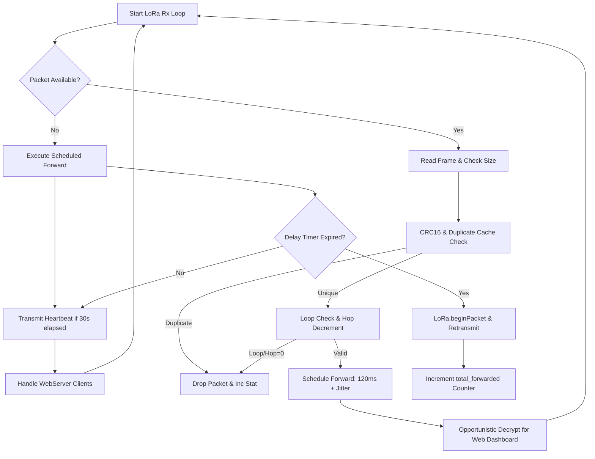

# 📡 LoRa Mesh Intermediate Repeater 01 (Slot 1 Forwarder)
**Firmware Target:** `Repeater_01.ino`  
**Node Identifier:** `REP_01`  
**Forwarding Profile:** Primary Priority Relay (120ms Base Backoff + 0–80ms Jitter)  
**Hardware Platform:** ESP32-WROOM-32 (30-Pin / 38-Pin DevKit V1) + Semtech SX1278 Ra-02 LoRa  
**Local Web Access:** Standalone SoftAP (`192.168.4.1`) with Live Diagnostic Dashboard  
**Mesh Protocol:** Controlled Flooding with Bounded Cache & Slotted Collision Avoidance  

---

## 📑 Table of Contents
1. [Role in Mesh Architecture](#1-role-in-mesh-architecture)
2. [Hardware Specifications & Bill of Materials](#2-hardware-specifications--bill-of-materials)
3. [Circuit Schematic & Pinout Matrix](#3-circuit-schematic--pinout-matrix)
4. [Mesh Routing Theory & Store-and-Forward Mechanics](#4-mesh-routing-theory--store-and-forward-mechanics)
   - [Slotted Aloha & Channel Contention Avoidance](#41-slotted-aloha--channel-contention-avoidance)
   - [Ring-Buffer De-duplication Cache](#42-ring-buffer-de-duplication-cache)
   - [Routing Loop Suppression & Path Accumulation](#43-routing-loop-suppression--path-accumulation)
   - [Hop-to-Live (TTL) Decrementation](#44-hop-to-live-ttl-decrementation)
5. [Opportunistic In-Flight Telemetry Sniffing](#5-opportunistic-in-flight-telemetry-sniffing)
6. [Standalone SoftAP & Real-Time Web Dashboard](#6-standalone-softap--real-time-web-dashboard)
7. [Software Execution State Machine](#7-software-execution-state-machine)
8. [Serial Diagnostics & Operational Telemetry](#8-serial-diagnostics--operational-telemetry)
9. [Deployment & Field Installation Guide](#9-deployment--field-installation-guide)

---

## 1. Role in Mesh Architecture

In marine surface IoT networks, direct Line-of-Sight (LoS) between the mobile boat node (`BOAT_001`) and the shore base station (`GATEWAY`) is often obstructed by water surface curvature, terrain headlands, shoreline foliage, or atmospheric ducting.

**Repeater 01 (`REP_01`)** acts as the primary relay station, typically positioned on an elevated shoreline tower, pier, or buoy. It implements an asynchronous **Store-and-Forward** algorithm to capture weak boat packets, regenerate RF symbols at full power (+17 dBm), and propagate them to the central gateway:

```
[BOAT_001] (Tx: +17 dBm)
      │
      ├─── Direct Weak Path (High Path Loss / Obstructed) ───▶ [GATEWAY]
      │
      ▼
[REPEATER_01] (Elevated Shore Node)
      │  - Receives packet (RSSI: -92 dBm, SNR: +6 dB)
      │  - Verifies CRC16 & Checks Duplicate Cache
      │  - Waits Backoff Slot 1 (120ms + Jitter)
      │  - Appends "REP_01" to path header
      │  - Retransmits at full power (+17 dBm)
      │
      └─────────────────────────────────────────────────────▶ [GATEWAY] (Rx: Strong LoS)
```

---

## 2. Hardware Specifications & Bill of Materials

| Component | Model / Specification | Purpose | Operating Voltage | Interface |
|---|---|---|---|---|
| **Microcontroller** | ESP32 DevKit V1 (Xtensa Dual-Core 32-bit @ 240 MHz, 520 KB SRAM) | Mesh State Machine, SoftAP Web Server, Crypto Engine | 3.3V (5V via USB/VIN) | High-speed SPI, Wi-Fi 802.11b/g/n |
| **LoRa Radio** | Semtech SX1278 (Ai-Thinker Ra-02 433 MHz) | Mesh packet reception and scheduled retransmission | 3.3V (Max 3.6V!) | Hardware SPI @ 10 MHz |
| **RF Antenna** | 433 MHz Omni-Directional High-Gain Fiberglass / Dipole Antenna | Maximum RF coverage over water body | Passive RF | 50 Ω SMA / IPEX Coaxial |
| **Power Supply** | 5V Solar Charge Controller + 3.7V 18650 Li-ion Cell (or 5V Powerbank) | Continuous off-grid shoreline operation | 3.7V – 5.0V | 2-pin JST / USB |
| **Status LED** | Onboard ESP32 LED (GPIO 2) | Packet Rx/Tx blink indication | 3.3V | Digital GPIO |

---

## 3. Circuit Schematic & Pinout Matrix

> [!CAUTION]
> The **Semtech SX1278 Ra-02 LoRa module operates strictly at 3.3V**. Connecting the module to 5V will permanently burn the silicon.

### Complete ESP32 to SX1278 Ra-02 Wiring

| ESP32 Pin | SX1278 Ra-02 Pin | Signal | Electrical Description |
|---|---|---|---|
| **GPIO 18** | `SCK` | SPI Serial Clock | Clock line driven by ESP32 master |
| **GPIO 19** | `MISO` | SPI Master-In Slave-Out | Data from SX1278 to ESP32 |
| **GPIO 23** | `MOSI` | SPI Master-Out Slave-In | Data from ESP32 to SX1278 |
| **GPIO 5** | `NSS / CS` | SPI Slave Select | Active-low chip select |
| **GPIO 14** | `RST` | Hardware Reset | Active-low transceiver reset |
| **GPIO 2** | `DIO0` | Interrupt / RxDone | High on packet reception |
| **3.3V** | `VCC` | Power Supply | Pure 3.3V power rail (Draws up to 120 mA during Tx) |
| **GND** | `GND` | Ground Reference | Common ground |

---

## 4. Mesh Routing Theory & Store-and-Forward Mechanics

### 4.1. Slotted Aloha & Channel Contention Avoidance
When the boat broadcasts a packet, both `REP_01` and `REP_02` may hear it simultaneously. If both retransmitted immediately, their transmissions would collide on 433.0 MHz, destroying both frames at the Gateway receiver.

To eliminate contention, our architecture enforces a **Deterministic Slotted Backoff with Random Jitter**:
$$T_{\text{forward}} = T_{\text{base}} + \Delta T_{\text{jitter}}$$

For **Repeater 01 (Slot 1 Forwarder)**:
$$T_{\text{base, 1}} = 120\text{ ms}, \quad \Delta T_{\text{jitter, 1}} \in [0, 80\text{ ms}]$$
$$T_{\text{forward, 1}} \in [120\text{ ms}, 200\text{ ms}]$$

In contrast, **Repeater 02 (Slot 2 Forwarder)** operates on:
$$T_{\text{base, 2}} = 280\text{ ms}, \quad \Delta T_{\text{jitter, 2}} \in [0, 90\text{ ms}] \implies [280\text{ ms}, 370\text{ ms}]$$

Because a typical LoRa transmission at SF7/125kHz lasts $\approx 150\text{ ms}$, Slot 1 completely vacates the RF medium before Slot 2 begins, guaranteeing zero collision between repeaters!

### 4.2. Ring-Buffer De-duplication Cache
To avoid storm loops, `REP_01` maintains a cyclic hash cache of size $N = 32$:
```cpp
struct DuplicateCacheEntry {
    char source_id[MESH_MAX_NODE_ID_LEN];
    uint32_t session_id;
    uint32_t sequence_id;
    unsigned long seen_timestamp_ms;
};
```
When a frame arrives:
1. The forwarder scans `dupCache`. If `(source_id == cached.source && session_id == cached.session && sequence_id == cached.seq)` AND $(t_{\text{current}} - t_{\text{seen}} < 90000\text{ ms})$, the packet is tagged as **`DUPLICATE_FRAME`** and dropped immediately.
2. If new, the entry is inserted at index `dupCacheHead = (dupCacheHead + 1) % 32`.

### 4.3. Routing Loop Suppression & Path Accumulation
A packet cannot pass through the same node twice. Before forwarding:
```cpp
// Check if THIS_NODE_ID is already part of the accumulated route
if (strstr(header.route_path, THIS_NODE_ID) != nullptr) {
    meshStats.routing_loops++;
    return; // Drop! Packet has already traversed this node.
}
```
If safe, `REP_01` appends its identifier to the route header:
$$\text{Route}_{\text{new}} = \text{Route}_{\text{orig}} \parallel \text{" -> REP-01"}$$

### 4.4. Hop-to-Live (TTL) Decrementation
Each packet carries `header.hop_count` (initialized to 4). Upon receipt:
$$\text{HopCount} = \text{HopCount} - 1$$
If $\text{HopCount} \le 0$, the frame has expired and is discarded (`meshStats.expired_hops++`).

---

## 5. Opportunistic In-Flight Telemetry Sniffing

Unlike basic dumb transparent repeaters, `REP_01` performs **Dual-Plane Processing**:
1. **Control / Forwarding Plane:** Preserves the exact authenticated ciphertext and GMAC tag without re-encryption, ensuring complete end-to-end cryptographic integrity between Boat and Gateway.
2. **Management Plane:** Clones the payload buffer into local memory, validates the AES-GCM tag using the shared key, decompresses the LZSS stream, and extracts the physical metrics into `latestTelemetry`. This enables field technicians to view boat telemetry locally from the repeater's Wi-Fi hotspot even if the main gateway is offline!

---

## 6. Standalone SoftAP & Real-Time Web Dashboard

Repeater 01 broadcasts a dedicated Wi-Fi access point for on-site monitoring and antenna alignment:
- **SSID:** `LoRa_Mesh_Repeater_01`
- **Password:** `repeater01`
- **IP Address:** `http://192.168.4.1/`

### Dashboard Capabilities
- **Mesh Routing Statistics:** Live counters for packets forwarded, received, duplicates rejected, CRC errors, and loop suppressions.
- **LoRa Radio Parameters:** Frequency (433.0 MHz), Sync Word (`0xF3`), Spreading Factor (SF7), Bandwidth (125 kHz), Slot timing.
- **Latest Boat Telemetry:** Water temperature, pH, TDS, Turbidity, Air parameters, GPS coordinates, Roll/Pitch attitude, Signal RSSI/SNR.
- **Mesh Node Heartbeat & Status Tracker:** Real-time table displaying all detected nodes, liveness state (`ONLINE`, `STALE`, `OFFLINE`), hops, packets, and full observed multi-hop paths.
- **Mobile Responsive Design:** Horizontally swipeable table with custom scrollbars, dark mode styling, and anti-cache endpoints.

---

## 7. Software Execution State Machine



---

## 8. Serial Diagnostics & Operational Telemetry

When connected to a PC via USB Serial (**115200 baud**):
```
=================================================================
       ESP32 LORA MESH REPEATER 01 FIRMWARE (REP_01)            
=================================================================
[SoftAP] Started SSID: LoRa_Mesh_Repeater_01 | Pass: repeater01
[SoftAP] Web Dashboard URL: http://192.168.4.1/
[WebServer] HTTP Server started on port 80.
[LoRa] Radio ready: 433.0 MHz, Sync 0xF3, SF7, BW 125 kHz
[REP_01] Slot 1 Forwarding Engine Active (Base Backoff: 120 ms)

[REP_01 RX] Packet #14 from BOAT_001 (RSSI=-84 dBm, SNR=7.2 dB, Hops=3)
[REP_01 RX] Route: [BOAT_001 -> REP_01]
[REP_01 SCHED] Scheduled Forwarding in 154 ms (Slot 1)
[REP_01 DECODE] Telemetry decrypted: Temp=26.4°C, pH=7.35, TDS=245ppm
[REP_01 FWD] Forwarded Packet #14 from BOAT_001 (Result=1, 62 bytes)
[HEARTBEAT TX] REP_01 Heartbeat sent (Fwd: 1, Drops: 0)
```

---

## 9. Deployment & Field Installation Guide

1. **Elevation:** Mount the repeater at least **3 to 5 meters above ground/water level** to achieve line-of-sight and clear the 1st Fresnel zone.
2. **Antenna Orientation:** Keep the 433 MHz antenna **strictly vertical** (polarization alignment matches the boat and gateway antennas).
3. **Power Budget:** The ESP32 with Wi-Fi AP active consumes $\approx 110\text{ mA}$ average. A single 3000 mAh 18650 cell can power the repeater for $\approx 27\text{ hours}$ standalone, or indefinitely when paired with a 5W solar panel and TP4056/BMS module.
4. **Verification:** Connect a smartphone to `LoRa_Mesh_Repeater_01`, navigate to `http://192.168.4.1/`, and verify that the `Mesh Node Heartbeat & Status Tracker` marks `BOAT_001` as `ONLINE`.
