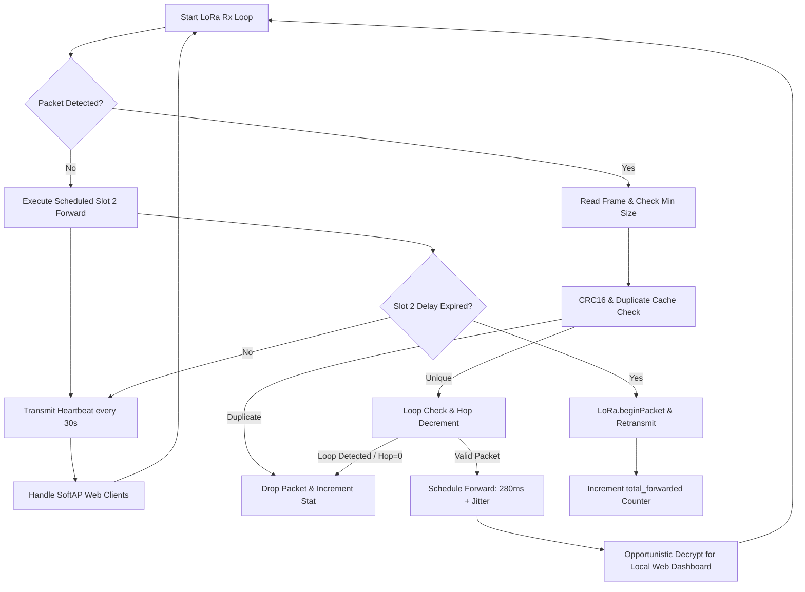

# 📡 LoRa Mesh Secondary Repeater 02 (Slot 2 Forwarder)
**Firmware Target:** `Repeater_02.ino`  
**Node Identifier:** `REP_02`  
**Forwarding Profile:** Secondary Spatial Diversity Relay (280ms Base Backoff + 0–90ms Jitter)  
**Hardware Platform:** ESP32-WROOM-32 (30-Pin / 38-Pin DevKit V1) + Semtech SX1278 Ra-02 LoRa  
**Local Web Access:** Standalone SoftAP (`192.168.4.1`) with Live Diagnostic Dashboard  
**Mesh Protocol:** Controlled Flooding with Spatial Macro-Diversity & Contention Offset  

---

## 📑 Table of Contents
1. [Role in Mesh Architecture & Diversity Theory](#1-role-in-mesh-architecture--diversity-theory)
2. [Slot 2 Timing & Contention Offset Mathematical Analysis](#2-slot-2-timing--contention-offset-mathematical-analysis)
3. [Hardware Specifications & Bill of Materials](#3-hardware-specifications--bill-of-materials)
4. [Circuit Schematic & Pinout Matrix](#4-circuit-schematic--pinout-matrix)
5. [Mesh Routing Engine & Multi-Hop Path Rules](#5-mesh-routing-engine--multi-hop-path-rules)
6. [Opportunistic In-Flight Telemetry Sniffing](#6-opportunistic-in-flight-telemetry-sniffing)
7. [Standalone SoftAP & Real-Time Web Dashboard](#7-standalone-softap--real-time-web-dashboard)
8. [Software Execution State Machine](#8-software-execution-state-machine)
9. [Serial Diagnostics & Operational Telemetry](#9-serial-diagnostics--operational-telemetry)
10. [Geographical Placement & Field Topology](#10-geographical-placement--field-topology)

---

## 1. Role in Mesh Architecture & Diversity Theory

In aquatic environments, a single repeater setup remains susceptible to **shadow fading** caused by topographical variations (such as islands, coastal headlands, dense tree lines, and bridge embankments).

**Repeater 02 (`REP_02`)** serves as a **Secondary Spatial Diversity Relay**. Operating at a physically distinct geographic location from `REP_01`, it guarantees that if the vessel enters an RF shadow relative to `REP_01`, `REP_02` captures and relays the transmission:

```
                          ┌──▶ [REPEATER_01] (Slot 1: 120ms) ──▶ [GATEWAY]
                          │             ▲
[BOAT_001] (Transmitter) ─┤             │ (Optional Multi-Hop Relay)
                          │             ▼
                          └──▶ [REPEATER_02] (Slot 2: 280ms) ──▶ [GATEWAY]
```

### Macro-Diversity Gain
By deploying two spatially separated repeaters, the network achieves **Spatial Macro-Diversity**. The probability that both independent relay links fail simultaneously is the product of their individual outage probabilities:
$$P_{\text{outage, total}} = P_{\text{outage, REP1}} \times P_{\text{outage, REP2}}$$
If each independent link experiences a 10% packet drop rate ($P = 0.10$), the combined dual-repeater mesh reduces overall packet loss to:
$$P_{\text{outage, total}} = 0.10 \times 0.10 = 0.01\ (1\%)$$
This yields a **99% packet delivery guarantee** even under severe environmental multipath fading.

---

## 2. Slot 2 Timing & Contention Offset Mathematical Analysis

The critical architectural difference between `Repeater_01` and `Repeater_02` is their **Scheduled Store-and-Forward Backoff Time**:

| Parameter | Repeater 01 (Slot 1) | Repeater 02 (Slot 2) | Channel Separation Mechanism |
|---|---|---|---|
| **Base Backoff ($T_{\text{base}}$)** | $120\text{ ms}$ | **$280\text{ ms}$** | $+160\text{ ms}$ intentional offset |
| **Random Jitter ($T_{\text{jitter}}$)** | $0 - 80\text{ ms}$ | **$0 - 90\text{ ms}$** | Independent uniform RNG |
| **Effective Delay Window** | $120 - 200\text{ ms}$ | **$280 - 370\text{ ms}$** | **Clear Guard Band ($\ge 80\text{ ms}$)** |

### Mathematical Collision Avoidance Proof
At Spreading Factor 7 and 125 kHz bandwidth, an 80-byte encrypted telemetry packet has a Time on Air (ToA) of $\approx 148.7\text{ ms}$.
- **Slot 1 (REP_01):** Transmits at $t \in [120, 200]\text{ ms}$. Transmission concludes latest at:
  $$T_{\text{end, REP1}} = 200\text{ ms} + 148.7\text{ ms} = 348.7\text{ ms}$$
- **Slot 2 (REP_02):** Begins transmission at $t \in [280, 370]\text{ ms}$.

Because `REP_02` actively listens on the RF channel prior to transmitting, if `REP_02` hears `REP_01`'s forwarded packet, its duplicate cache flags the sequence number. Furthermore, the base offset ensures that `REP_01` has the primary opportunity to reach the gateway with minimal latency, while `REP_02` follows as the guaranteed secondary redundancy path.

---

## 3. Hardware Specifications & Bill of Materials

| Component | Model / Specification | Purpose | Operating Voltage | Interface |
|---|---|---|---|---|
| **Microcontroller** | ESP32 DevKit V1 (Xtensa Dual-Core 32-bit @ 240 MHz, 520 KB SRAM) | Mesh State Machine, SoftAP Web Server, Crypto Engine | 3.3V (5V via USB/VIN) | High-speed SPI, Wi-Fi 802.11b/g/n |
| **LoRa Radio** | Semtech SX1278 (Ai-Thinker Ra-02 433 MHz) | Mesh packet reception and scheduled retransmission | 3.3V (Max 3.6V!) | Hardware SPI @ 10 MHz |
| **RF Antenna** | 433 MHz Omni-Directional High-Gain Fiberglass / Dipole Antenna | Maximum RF coverage over water body | Passive RF | 50 Ω SMA / IPEX Coaxial |
| **Power Supply** | 5V Solar Charge Controller + 3.7V 18650 Li-ion Cell (or 5V Powerbank) | Continuous off-grid shoreline operation | 3.7V – 5.0V | 2-pin JST / USB |
| **Status LED** | Onboard ESP32 LED (GPIO 2) | Packet Rx/Tx blink indication | 3.3V | Digital GPIO |

---

## 4. Circuit Schematic & Pinout Matrix

> [!CAUTION]
> The **Semtech SX1278 Ra-02 LoRa module operates strictly at 3.3V**. Connecting the module to 5V will permanently burn the silicon.

### Complete ESP32 to SX1278 Ra-02 Wiring

| ESP32 Pin | SX1278 Ra-02 Pin | Signal | Electrical Description |
|---|---|---|---|
| **GPIO 18** | `SCK` | SPI Serial Clock | Clock line driven by ESP32 master |
| **GPIO 19** | `MISO` | SPI Master-In Slave-Out | Data from SX1278 to ESP32 |
| **GPIO 23** | `MOSI` | SPI Master-Out Slave-In | Data from ESP32 to SX1278 |
| **GPIO 5** | `NSS / CS` | SPI Slave Select | Active-low chip select |
| **GPIO 14** | `RST` | Hardware Reset | Active-low transceiver reset |
| **GPIO 2** | `DIO0` | Interrupt / RxDone | High on packet reception |
| **3.3V** | `VCC` | Power Supply | Pure 3.3V power rail (Draws up to 120 mA during Tx) |
| **GND** | `GND` | Ground Reference | Common ground |

---

## 5. Mesh Routing Engine & Multi-Hop Path Rules

Repeater 02 implements four strict packet filtering criteria:

1. **Integrity Check:** Packet must have a valid CRC16 footer and valid `MeshHeader` magic byte sequence.
2. **De-duplication Check:** Bounded cyclic cache ($N = 32$) rejects any frame having identical `(source_id, session_id, sequence_id)` seen within the last 90 seconds.
3. **Loop Detection:** If `strstr(header.route_path, "REP_02") != nullptr`, the packet is dropped immediately to prevent cyclic oscillation between repeaters.
4. **Hop Decrement & Route Expansion:**
   - Hop count decremented: $\text{HopCount} = \text{HopCount} - 1$.
   - If $\text{HopCount} \le 0$, drop as expired.
   - Appends node ID:
     $$\text{Route}_{\text{new}} = \text{Route}_{\text{orig}} \parallel \text{" -> REP-02"}$$

---

## 6. Opportunistic In-Flight Telemetry Sniffing

To enable independent field verification without relying on the central Gateway:
- `REP_02` inspects passing frames. If the payload is a `MSG_TYPE_TELEMETRY` packet from `BOAT_001`, it decrypts the AES-128-GCM ciphertext using the hardware AES engine and the shared network key.
- It verifies the 16-byte GMAC authentication tag.
- It decompresses the LZSS byte stream into a `BinaryTelemetry` struct.
- The decoded physical sensor values (water temperature, pH, TDS, Turbidity, GPS, IMU) are stored in local RAM (`latestTelemetry`) and served through the internal web server.

---

## 7. Standalone SoftAP & Real-Time Web Dashboard

Repeater 02 broadcasts a standalone Wi-Fi hotspot:
- **SSID:** `LoRa_Mesh_Repeater_02`
- **Password:** `repeater02`
- **Web Dashboard URL:** `http://192.168.4.1/`

### Features & Mobile UI
- **Live Connection Badge:** Real-time polling indicator (`● Connecting...`, `● Live`, `● Reconnecting`).
- **Dynamic Status Banner:** Highlights live mesh reception and forwarder activity.
- **Mesh Routing Statistics:** Live counters for Forwarded, Received, Duplicates, Hop Exceeded, Routing Loops, and CRC rejections.
- **Boat Water Quality & Navigation:** Full readout of physical sensors and GPS coordinates with safe null-checking for indoor testing.
- **Mesh Node Heartbeat & Status Tracker:** Fully responsive, horizontally swipeable table displaying all active nodes, liveness status (`ONLINE`, `STALE`, `OFFLINE`), signal metrics (RSSI / SNR), and accumulated hop paths.

---

## 8. Software Execution State Machine



---

## 9. Serial Diagnostics & Operational Telemetry

Serial Monitor output at **115200 baud**:
```
=================================================================
       ESP32 LORA MESH REPEATER 02 FIRMWARE (REP_02)            
=================================================================
[SoftAP] Started SSID: LoRa_Mesh_Repeater_02 | Pass: repeater02
[SoftAP] Web Dashboard URL: http://192.168.4.1/
[WebServer] HTTP Server started on port 80.
[LoRa] Radio ready: 433.0 MHz, Sync 0xF3, SF7, BW 125 kHz
[REP_02] Slot 2 Forwarding Engine Active (Base Backoff: 280 ms)

[REP_02 RX] Packet #14 from BOAT_001 (RSSI=-91 dBm, SNR=5.8 dB, Hops=3)
[REP_02 RX] Route: [BOAT_001 -> REP_02]
[REP_02 SCHED] Scheduled Forwarding in 312 ms (Slot 2)
[REP_02 DECODE] Telemetry decrypted: Temp=26.4°C, pH=7.35, TDS=245ppm
[REP_02 FWD] Forwarded Packet #14 from BOAT_001 (Result=1, 62 bytes)
[HEARTBEAT TX] REP_02 Heartbeat sent (Fwd: 1, Drops: 0)
```

---

## 10. Geographical Placement & Field Topology

```
             [Lake / Water Reservoir]
                    ⛵ BOAT_001
                   /          \
                  /            \
                 /              \
                ▼                ▼
     [REP_01: West Shore]   [REP_02: East Shore]
     (Elevated Hilltop)      (Watchtower / Mast)
     Backoff: 120ms          Backoff: 280ms
                \                /
                 \              /
                  ▼            ▼
             [BASE STATION GATEWAY]
             (Research Lab / Control)
```

- **Placement Recommendation:** Position `REP_01` and `REP_02` on opposing sides of the water body to maximize angle of arrival diversity.
- **Line-of-Sight:** Ensure both repeaters have an unobstructed Fresnel zone towards the Base Station Gateway.
- **Power Autonomy:** An inexpensive 5V 1A solar panel and lithium 18650 cell provide 24/7 autonomous operation without requiring mains electricity.
